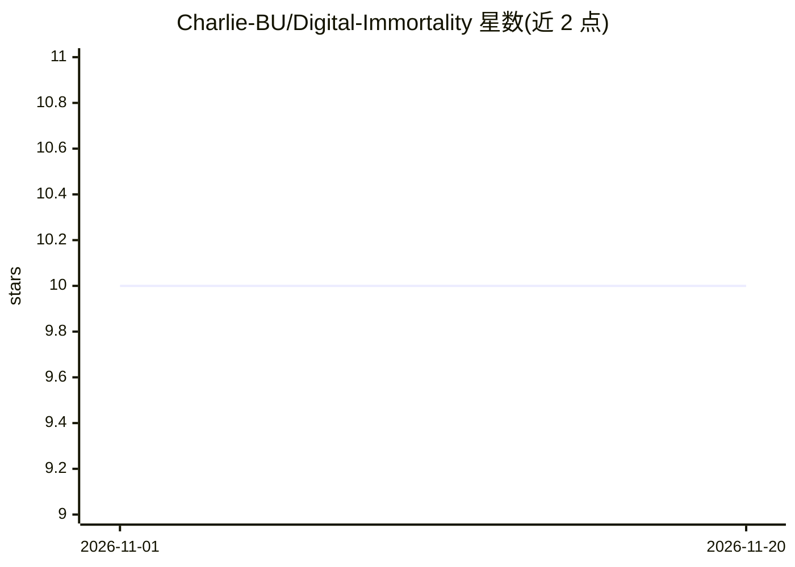

# Charlie-BU/Digital-Immortality

⭐ 10 · Python · 推送 2026-06-04 · [GitHub](https://github.com/Charlie-BU/Digital-Immortality) · [官网](https://pypi.org/project/Digital-Immortality/) · 个人维护 · 中文 README

**基于结构化记忆与向量检索的数字分身 agent CLI**

以 Python CLI 形式分发的个人数字分身系统：将人物画像与对话存入 PostgreSQL（pgvector 向量检索），通过 LangChain/LangGraph 编排 agent 工作流，接入火山方舟平台的 Lite/Mini/Embedding 三类模型，并经由飞书机器人提供对话交互。安装路径包括 uv tool / pip（PyPI 包），数据库推荐用 Docker 自动拉起 pgvector/pgvector:pg16 镜像；运行依赖 immortality doctor 健康检查、账号注册登录与飞书 open_id 绑定。限制：模型仅支持火山方舟平台配置的模型。

## 筛选速览

| 维度 | 判定 | 备注 |
|---|---|---|
| AI 角色 | `ai-native` | 本体是模型或模型工具 |
| 许可风险 | `none` | — |
| 部署形态 | `self-host` | docker 或自建部署 |
| 模型依赖 | — | README 未给出锁定关系 |
| 硬件要求 | — | 无带数字的原话,不猜 |
| 安装摩擦 | `low` | 无编译、无系统依赖或容器化 |
| 成熟度 | — | 结构信号不足 |

## 能力要点

- PostgreSQL + pgvector 的结构化记忆与向量检索
- 火山方舟 doubao 系列 Lite/Mini/Embedding 三类模型配置
- 飞书机器人链路：长连接接收事件、卡片模板、菜单命令
- immortality doctor 健康检查与 Docker 一键拉起数据库

## 适用场景

- 在飞书中与自己的数字分身进行上下文感知的对话
- 长期沉淀个人聊天记录并做向量化的画像完善
- 用 Cronjob 定时同步细粒度人物形象信息到固有画像

## 场景标签

`AI 助手` `Agent 记忆` `聊天机器人` · 领域:Agent 开发

## 证据(README 行号)

> L134: > 当前服务仅支持 火山方舟平台 (https://console.volcengine.com/ark) 配置的模型，但你可以在火山方舟平台选择其支持的其他模型。
> L260: - 启动 `PostgreSQL`（镜像为 `pgvector/pgvector:pg16`）

## 星数曲线

2026-11-01 10 → 2026-11-20 10（+0）

---
*卡片 v1 · prompt 1.4 · 生成 2026-11-20 · 置信度 high · 依据 README sha `26291aad5cc5` · [字段定义](../../DATASET.md)*
