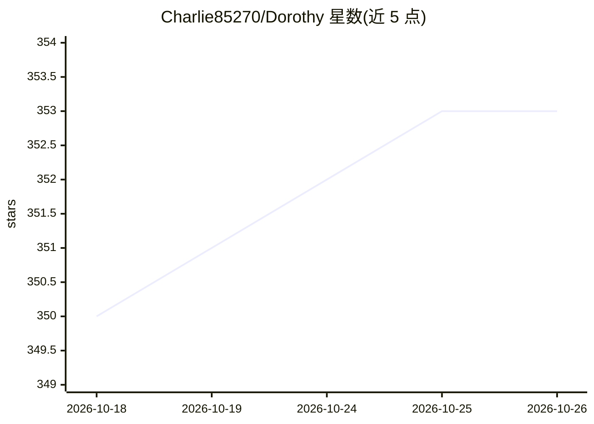

# Charlie85270/Dorothy

⭐ 353 · TypeScript · MIT · 推送 2026-10-23 · [GitHub](https://github.com/Charlie85270/Dorothy) · [官网](https://dorothyai.app) · 个人维护

**编排 Claude Code/Codex/Gemini/Grok 等 AI CLI 代理的桌面应用**

开源桌面应用，用于并行运行和管理多个 AI CLI 代理（Claude Code、Codex、Gemini、Grok 及本地代理）：每个代理在隔离 PTY 终端中运行，Super Agent 通过 MCP 工具创建、启动、停止和委派其他代理。提供 GitHub/JIRA 事件触发的自动化流水线、cron 定时任务、Kanban 看板与技能自动分配、Telegram/Slack 远程控制、SQLite FTS5 全文检索的共享文档库（Vault），以及 Twitter 与 Google Workspace 的 MCP 工具。支持 macOS（launchd）与 Linux（cron）的定时调度。

## 筛选速览

| 维度 | 判定 | 备注 |
|---|---|---|
| AI 角色 | `ai-ecosystem` | LLM/agent 周边工具 |
| 许可风险 | `permissive` | MIT |
| 部署形态 | `library` | 以包/库形式分发 |
| 模型依赖 | — | README 未给出锁定关系 |
| 硬件要求 | — | 无带数字的原话,不猜 |
| 安装摩擦 | `low` | 无编译、无系统依赖或容器化 |
| 成熟度 | — | 结构信号不足 |

## 能力要点

- 并行运行 10+ 代理，各自隔离 PTY 终端，状态跨重启持久化
- Super Agent 经 MCP 工具程序化编排代理池
- GitHub PR/issue、JIRA 事件触发自动生成代理处理并投递结果
- Telegram/Slack 远程控制全部代理与用量统计

## 适用场景

- 同时跑多个 AI CLI 代理处理不同项目任务
- GitHub PR 提交时自动触发 AI 代码审查
- 通过 Telegram/Slack 从手机远程指挥代理舰队
- 用 Kanban 看板按技能自动把任务分配给代理

## 场景标签

`编码 Agent` `多智能体` `代码审查` · 领域:Agent 开发

## 证据(README 行号)

> L5: A beautiful desktop app to orchestrate your Claude Code ,Codex, Gemini, Grok and local agents. Deploy, monitor, and 
> L17: - **Delegate and coordinate** — a Super Agent orchestrates other agents via MCP tools
> L48: - Creates, starts, and stops agents programmatically via MCP tools

## 星数曲线

2026-10-18 350 → 2026-10-26 353（+3）

---
*卡片 v1 · prompt 1.4 · 生成 2026-10-21 · 置信度 mid · 依据 README sha `9814203bb7fb` · [字段定义](../../DATASET.md)*
