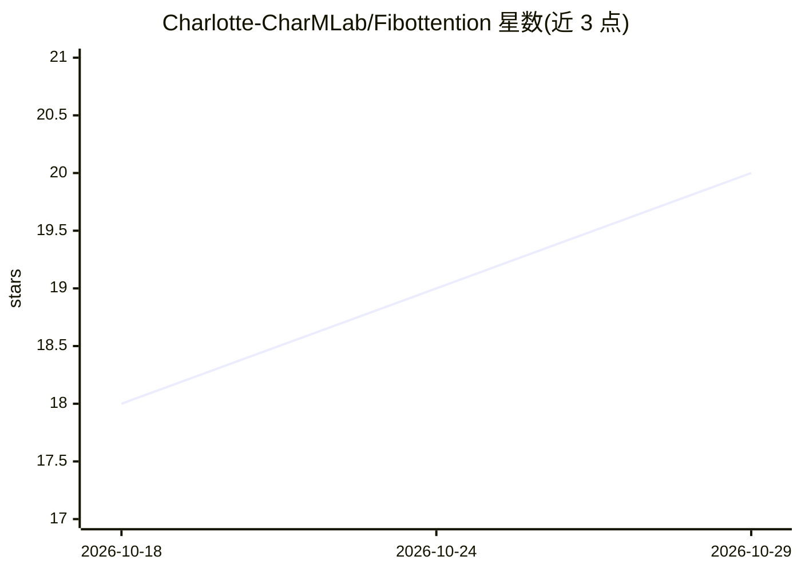

# Charlotte-CharMLab/Fibottention

⭐ 20 · Python · CC-BY-4.0 · 推送 2026-08-24 · [GitHub](https://github.com/Charlotte-CharMLab/Fibottention) · 组织维护

**稀疏自注意力机制 Fibottention 的官方 PyTorch 实现，供视觉表征学习研究**

论文 "Fibottention: Inceptive Visual Representation Learning with Diverse Attention Across Heads" 的官方代码库。提出基于 Wythoff 数组结构化稀疏模式的自注意力机制，将自注意力计算复杂度降至 O(N log N)，各注意力头使用不同稀疏模式以减少冗余交互。提供图像分类（基于 MAE 流程，script.sh 执行 main_finetune.py）、动作识别（基于 TimeSformer，支持 Smarthome/NTU/NUCLA 数据集配置）、机器人学习（基于 Crossway Diffusion，支持 can_ph/lift_ph/pusht 数据集）三套训练代码。面向使用 PyTorch 的深度学习科研人员，许可为 CC BY 4.0。

## 筛选速览

| 维度 | 判定 | 备注 |
|---|---|---|
| AI 角色 | `ai-native` | 本体是模型或模型工具 |
| 许可风险 | `viral` | CC-BY-4.0 |
| 部署形态 | `desktop` | 安装包/桌面程序 |
| 模型依赖 | — | README 未给出锁定关系 |
| 硬件要求 | — | 无带数字的原话,不猜 |
| 安装摩擦 | `low` | 无编译、无系统依赖或容器化 |
| 成熟度 | — | 结构信号不足 |

## 能力要点

- 基于 Wythoff 数组的稀疏自注意力，复杂度 O(N log N)
- 各注意力头稀疏模式不同，典型设置下仅用 2% 的两两交互
- 覆盖图像分类、动作识别、机器人学习三个领域的训练代码
- README 内给出三个核心算法伪代码（约束 Fibonacci 序列、多头掩码生成、单块 ViT 中的 Fibottention）

## 适用场景

- 复现论文中图像分类/动作识别/机器人学习的实验结果
- 在自有数据集上训练使用 Fibottention 的 ViT 模型
- 研究稀疏注意力机制的实现细节与掩码生成算法

## 场景标签

`科研工具` · 领域:学习与行业

## 证据(README 行号)

> L12: This repository contains the implementation of our proposed Fibottention mechanism and related algorithms.
> L17: Vision Transformers and their variants have achieved remarkable success in diverse visual perception tasks. Despite

## 星数曲线

2026-10-18 18 → 2026-10-29 20（+2）

---
*卡片 v1 · prompt 1.4 · 生成 2026-10-28 · 置信度 mid · 依据 README sha `7024ce545e9e` · [字段定义](../../DATASET.md)*
