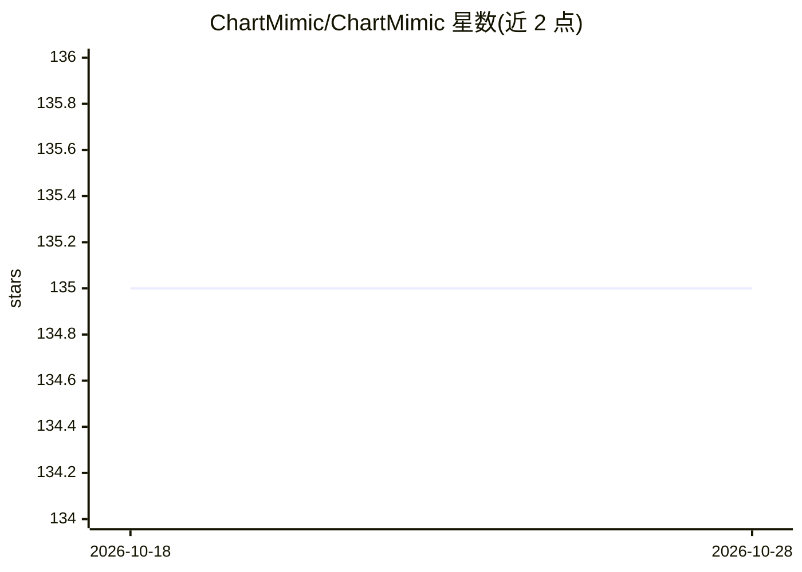

# ChartMimic/ChartMimic

⭐ 135 · Python · 推送 2025-12-19 · [GitHub](https://github.com/ChartMimic/ChartMimic) · [官网](https://chartmimic.github.io/) · 组织维护

**ICLR 2025 基准：评估多模态模型由图表生成代码的跨模态推理能力**

学术评测基准（ICLR 2025 论文）：以科研论文中的真实图表为输入，要求大型多模态模型（LMM）生成对应图表渲染代码，涵盖 Direct Mimic 与 Customized Mimic 两类任务。包含 4,800 组人工整理的（图、指令、代码）三元组，覆盖 18 种常规图表类型、4 种高级类型共 201 个子类，并提出多级自动评测指标。提供 14 个 LMM 的评测配置，数据托管于 HuggingFace，已被 Qwen3-VL 采纳为评测项并集成进 VLMEvalKit。

## 筛选速览

| 维度 | 判定 | 备注 |
|---|---|---|
| AI 角色 | `ai-knowledge` | 知识聚合/清单类 |
| 许可风险 | `none` | — |
| 部署形态 | `None` |  |
| 模型依赖 | — | README 未给出锁定关系 |
| 硬件要求 | — | 无带数字的原话,不猜 |
| 安装摩擦 | `low` | 无编译、无系统依赖或容器化 |
| 成熟度 | — | 结构信号不足 |

## 能力要点

- 4,800 组人工整理（figure, instruction, code）三元组，覆盖 201 个图表子类
- Direct Mimic 与 Customized Mimic 两类评测任务
- 多级评测指标自动评估输出代码与渲染图表
- 提供 14 个 LMM 模型的评测配置

## 适用场景

- 评测多模态模型的图表转代码生成与跨模态推理能力
- 在模型研发中作为多模态编码能力基准（如 Qwen3-VL 已采纳）
- 通过 VLMEvalKit 流程复现基准评测结果

## 场景标签

`模型评测` `多模态` · 领域:评测与运维

## 证据(README 行号)

> L21: ChartMimic aims at assessing **the visually-grounded code generation capabilities** of large multimodal models (LMM
> L23: ChartMimic includes **4,800 human-curated (figure, instruction, code) triplets**, which represent the authentic cha

## 星数曲线

2026-10-18 135 → 2026-10-28 135（+0）

---
*卡片 v1 · prompt 1.4 · 生成 2026-10-22 · 置信度 high · 依据 README sha `c027d1b27999` · [字段定义](../../DATASET.md)*
