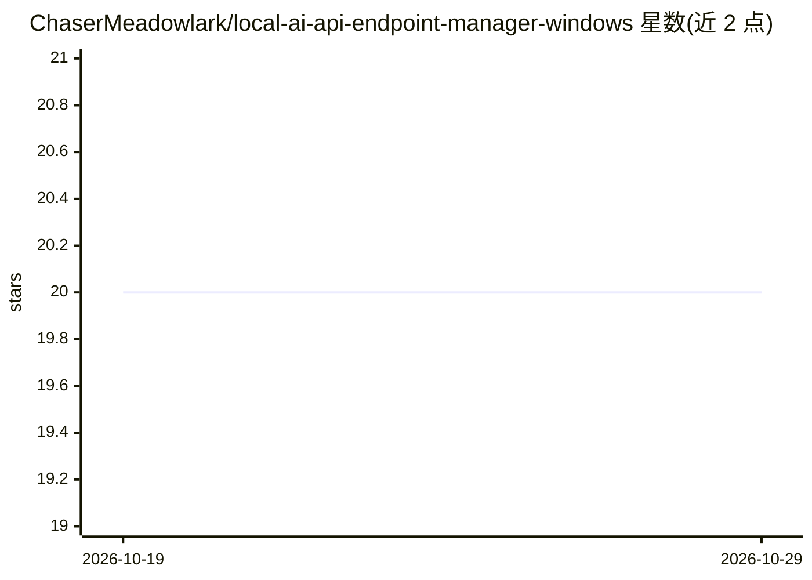

# ChaserMeadowlark/local-ai-api-endpoint-manager-windows

⭐ 20 · CSS · MIT · 推送 2026-10-19 · [GitHub](https://github.com/ChaserMeadowlark/local-ai-api-endpoint-manager-windows) · 个人维护

**Windows 本地 AI API 端点管理工具：组织配置、检查与恢复流程**

Windows 桌面小工具（单文件 exe，从 GitHub Releases 下载 ZIP 运行），围绕本地 AI API 服务器与 OpenAI 兼容 API 组织工作流：选择/检测模型、运行时、GPU 等 context，分析当前配置，保存/应用 profile，验证并可在需要时回滚到已知良好配置。README 以功能描述与 SEO 关键词为主，未给出具体的 API 管理实现细节；FAQ 声明非 Ollama、NVIDIA、AMD、微软官方工具，且不含商业模型。

## 筛选速览

| 维度 | 判定 | 备注 |
|---|---|---|
| AI 角色 | `ai-ecosystem` | LLM/agent 周边工具 |
| 许可风险 | `permissive` | MIT |
| 部署形态 | `desktop` | 安装包/桌面程序 |
| 模型依赖 | — | README 未给出锁定关系 |
| 硬件要求 | — | 无带数字的原话,不猜 |
| 安装摩擦 | `low` | 无编译、无系统依赖或容器化 |
| 成熟度 | — | 结构信号不足 |

## 能力要点

- 选择/检测—分析—应用—验证—恢复的五步配置工作流
- 变更前备份与可复用的配置 profile
- 以 OpenAI 兼容 API 为组织中心的本地工作流描述

## 适用场景

- 管理 Windows 上本地 AI 运行时与端点配置
- 配置变更前备份、变更后验证与回滚
- 整理本地 AI 设置与恢复步骤

## 场景标签

 · 领域:开发者工具/本地 AI 基础设施

## 证据(README 行号)

> L19: **Local AI API Endpoint Manager for Windows** is designed to organize a Windows workflow around **local AI API serv
> L43: 1. **Select / Detect** — choose the relevant model, runtime, GPU, API, or storage context.

## 星数曲线

2026-10-19 20 → 2026-10-29 20（+0）

---
*卡片 v1 · prompt 1.4 · 生成 2026-10-28 · 置信度 low · 依据 README sha `ed7d6d105366` · [字段定义](../../DATASET.md)*
