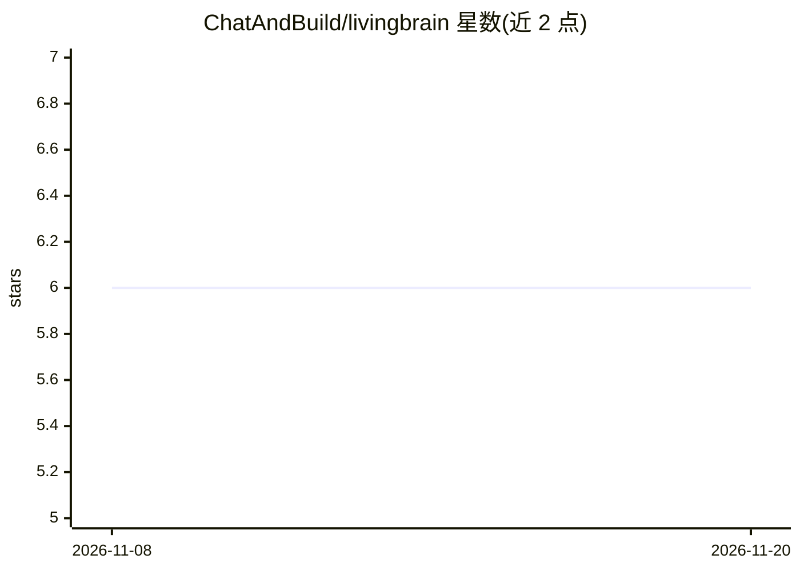

# ChatAndBuild/livingbrain

⭐ 6 · 推送 2026-10-27 · [GitHub](https://github.com/ChatAndBuild/livingbrain) · [官网](https://livingbrain.com/) · 组织维护

**跨 AI 工具携带的持久记忆层：MCP/API 接入**

Living Brain 是一个面向 AI 工具的互操作持久记忆层：用户创建承载项目/研究/团队知识的 Brain，通过 MCP（登录或 API 凭证）或 API/TypeScript SDK/CLI 接入 ChatGPT、Claude、Gemini、Claude Code、Codex、Cursor 等宿主工具，使上下文可跨模型与工作流延续。README 报告在 LongMemEval S 上最高 22.6× token 节省，并自报 LoCoMo/LongMemEval 排名，同时注明这些为团队自报结果、需独立评估。README 未给出本地安装命令，接入依赖宿主应用对 MCP/API 的支持。

## 筛选速览

| 维度 | 判定 | 备注 |
|---|---|---|
| AI 角色 | `ai-ecosystem` | LLM/agent 周边工具 |
| 许可风险 | `none` | — |
| 部署形态 | `None` |  |
| 模型依赖 | — | README 未给出锁定关系 |
| 硬件要求 | — | 无带数字的原话,不猜 |
| 安装摩擦 | `low` | 无编译、无系统依赖或容器化 |
| 成熟度 | `idea` | |

## 能力要点

- 通过 MCP 或 API 在多个 AI 工具间共享持久记忆
- 内置专有记忆评分机制（memory scoring）
- 提供 Quickstart、TypeScript SDK、CLI 等开发者接入途径
- 计划中的自托管基准套件 BrainBench（coming soon）

## 适用场景

- 在 ChatGPT、Claude、Gemini 之间延续同一项目的上下文
- 把项目决策与约束带入 Claude Code/Codex/Cursor 编码会话
- 在自己的应用中集成持久记忆层并自选模型

## 场景标签

`Agent 记忆` · 领域:Agent 开发

## 证据(README 行号)

> L5: **Living Brain is an interoperable, efficient memory layer for AI.** Connect through MCP or build with the API. Keep
> L27: The idea is simple: choose the AI experience you want, and connect your Living Brain through the client's supported

## 星数曲线

2026-11-08 6 → 2026-11-20 6（+0）

---
*卡片 v1 · prompt 1.4 · 生成 2026-11-20 · 置信度 high · 依据 README sha `1ab6dcd5993f` · [字段定义](../../DATASET.md)*
