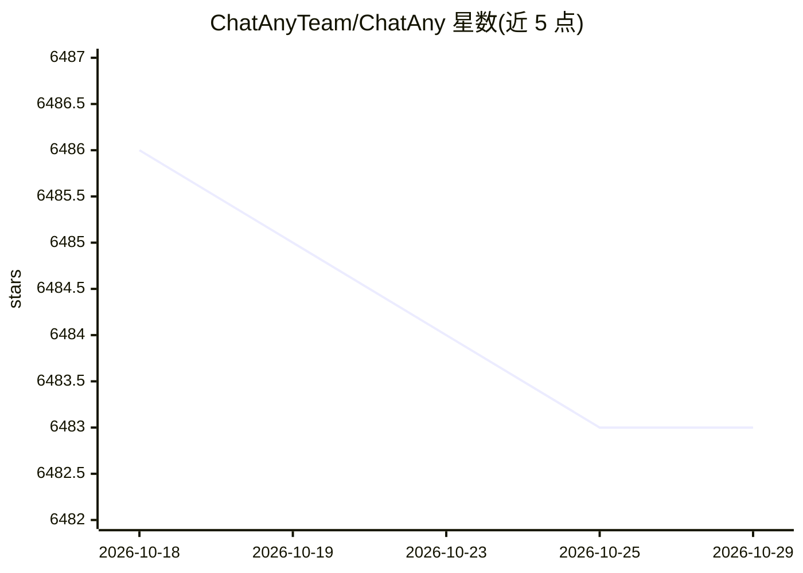

# ChatAnyTeam/ChatAny

⭐ 6,483 · TypeScript · MIT · 推送 2026-04-02 · [GitHub](https://github.com/ChatAnyTeam/ChatAny) · 个人维护 · 中文 README

**一键部署的 ChatGPT 聚合网页服务，附 AI 绘画能力**

基于 ChatGPT-Next-Web 二次开发的聚合 AI 对话网页服务，保留其全部功能，并新增 StabilityAI（Stable Image Ultra/Core、Stable Diffusion 3）与 Midjourney（非官方，经 midjourney-proxy API）图像生成，支持 Imagine/Upscale/Variation 等操作、区域重绘、参考图与绘图进度显示。提供 Docker、Vercel、Railway 与手动 npm 部署方式，另有收费 PRO 版本（含套餐、兑换码等运营功能）。README 顶部声明本项目已停止维护，指向替代项目 AQBot。

## 筛选速览

| 维度 | 判定 | 备注 |
|---|---|---|
| AI 角色 | `ai-native` | 本体是模型或模型工具 |
| 许可风险 | `permissive` | MIT |
| 部署形态 | `self-host` | docker 或自建部署 |
| 模型依赖 | — | README 未给出锁定关系 |
| 硬件要求 | — | 无带数字的原话,不猜 |
| 安装摩擦 | `low` | 无编译、无系统依赖或容器化 |
| 成熟度 | — | 结构信号不足 |

## 能力要点

- 在 ChatGPT-Next-Web 全部功能上叠加多家图像生成服务
- Midjourney（非官方）支持 Imagine/Upscale/Variation/区域重绘等操作与实时进度
- Docker/Vercel/Railway/手动 npm 多种部署途径
- README 声明已停止维护，推荐迁移至 AQBot

## 适用场景

- 自建一个带对话和 AI 绘画的个人网页服务
- 在同一界面切换使用 Stable Diffusion 与 Midjourney 生图
- 通过 Docker 一行命令快速部署使用

## 场景标签

`聊天机器人` `图像生成` · 领域:对话与助手

## 证据(README 行号)

> L11: 一键拥有你自己的 `ChatGPT`+`众多AI` 的聚合网页服务（基于ChatGPT-Next-Web开发）
> L30: - [x] 原`ChatGPT-Next-Web`所有功能

## 星数曲线

2026-10-18 6,486 → 2026-10-29 6,483（-3）

---
*卡片 v1 · prompt 1.4 · 生成 2026-10-20 · 置信度 high · 依据 README sha `bd663bce3bad` · [字段定义](../../DATASET.md)*
