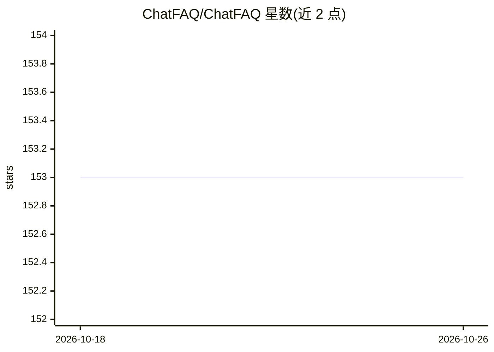

# ChatFAQ/ChatFAQ

⭐ 153 · Python · MIT · 推送 2025-12-11 · [GitHub](https://github.com/ChatFAQ/ChatFAQ) · [官网](https://www.chatfaq.io/) · 组织维护

**构建 RAG/Agent/FSM 对话方案的开源平台与框架**

面向企业对话场景的开源平台与框架，由 SDK、可嵌入网站聊天组件、管理后台、Ray 集群与 Django 后端组成。SDK 用于构建 Agent、RAG 管道与带 LLM 辅助的规则有限状态机；管理后台统一管理知识库、LLM、检索器并标注会话与查看统计。基础模型层以 vLLM 集成开源 LLM，另提供 OpenAI、Anthropic、Mistral、Gemini、Together 集成。README 未给出具体安装命令，官方文档托管于 Read the Docs。

## 筛选速览

| 维度 | 判定 | 备注 |
|---|---|---|
| AI 角色 | `ai-ecosystem` | LLM/agent 周边工具 |
| 许可风险 | `permissive` | MIT |
| 部署形态 | `None` |  |
| 模型依赖 | local-ok | 支持本地模型 |
| 硬件要求 | — | 无带数字的原话,不猜 |
| 安装摩擦 | `low` | 无编译、无系统依赖或容器化 |
| 成熟度 | — | 结构信号不足 |

## 能力要点

- SDK 构建 Agent、RAG 管道、FSM 等多种 AI 流程
- 管理后台管理知识库、LLM、检索器并标注会话
- vLLM 集成开源 LLM，另有 OpenAI/Anthropic/Mistral/Gemini/Together 集成
- 提供 LLM、RAG、结构化抽取等 SDK 示例

## 适用场景

- 搭建 RAG 增强的企业客服聊天机器人
- 构建带 LLM 辅助的规则状态机对话流程
- 在自有网站嵌入可定制的聊天组件并用后台管理知识库

## 场景标签

`RAG` `Agent 框架` `聊天机器人` · 领域:Agent 开发

## 证据(README 行号)

> L26: - **ChatFAQ SDK**: A SDK to build agents, RAG pipelines, Finite State Machines and any other AI flow you can imagin
> L33:  - Primary: vLLM integration for open-source LLMs

## 星数曲线

2026-10-18 153 → 2026-10-26 153（+0）

---
*卡片 v1 · prompt 1.4 · 生成 2026-10-22 · 置信度 high · 依据 README sha `3f43635366cf` · [字段定义](../../DATASET.md)*
