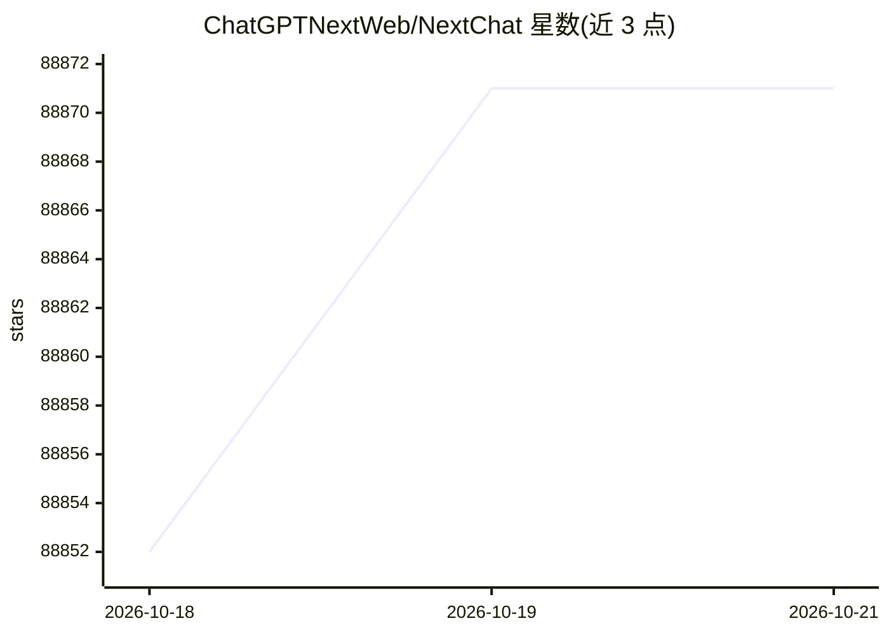

# ChatGPTNextWeb/NextChat

⭐ 88,871 · TypeScript · MIT · 推送 2026-10-15 · [GitHub](https://github.com/ChatGPTNextWeb/NextChat) · [官网](https://nextchat.club) · 组织维护 · 中文 README

**给消费者/开发者提供零配置跨平台 AI 聊天客户端**

基于 Next.js 的跨平台 AI 聊天助手客户端，提供 Web、iOS、macOS、Android、Linux、Windows 版本。通过环境变量接入 OpenAI、Azure、Gemini、Claude、DeepSeek、百度、字节、阿里、讯飞、ChatGLM 等多家服务，支持自定义模型列表与视觉模型；提供 prompt 模板（mask）、聊天记录自动压缩、WebDAV 同步、访问密码控制，数据存于浏览器本地。可一键部署到 Vercel 或用 Docker 运行，另设有企业版提供私有部署与权限管理。

## 筛选速览

| 维度 | 判定 | 备注 |
|---|---|---|
| AI 角色 | `ai-ecosystem` | LLM/agent 周边工具 |
| 许可风险 | `permissive` | MIT |
| 部署形态 | `self-host` | docker 或自建部署 |
| 模型依赖 | locked-api |  |
| 硬件要求 | — | 无带数字的原话,不猜 |
| 安装摩擦 | `low` | 无编译、无系统依赖或容器化 |
| 成熟度 | — | 结构信号不足 |

## 动量与使用信号

- 维护:`active` — 距上次 push 3.0 天,年发版 0,262 位贡献者
- 涨星:近 1 天 **-2**(自 20261016 起算)
- 下载:GitHub Release 附件 累计 698,515(77 个 release)
- 平台:WINDOWS / MACOS / LINUX / IOS / WEB · 协议:OPENAI-API / MCP

## 能力要点

- 一次部署接入 OpenAI/Azure/Gemini/Claude/DeepSeek/百度/字节/阿里/讯飞/ChatGLM 等多家 API
- 支持 MCP（Model Context Protocol），通过 ENABLE_MCP=true 开启
- 聊天记录自动压缩以支持长对话并节省 token，支持 WebDAV 同步
- 客户端体积约 5MB，覆盖六大平台

## 适用场景

- 自建一个网页版多模型 AI 聊天站供个人或团队使用
- 在桌面和手机上使用同一套聊天客户端
- 企业管理员统一配置多个 AI 资源并控制成员权限（企业版）

## 场景标签

`聊天机器人` `AI 助手` · 领域:对话与助手

## 证据(README 行号)

> L67: - **Deploy for free with one-click** on Vercel in under 1 minute
> L69: - Fully compatible with self-deployed LLMs, recommended for use with RWKV-Runner or LocalAI
> L176: ### `ANTHROPIC_API_KEY` (optional)

## 星数曲线

2026-10-18 88,852 → 2026-10-21 88,871（+19）

---
*卡片 v1 · prompt 1.4 · 生成 2026-10-18 · 置信度 high · 依据 README sha `98feca52d603` · [字段定义](../../DATASET.md)*
