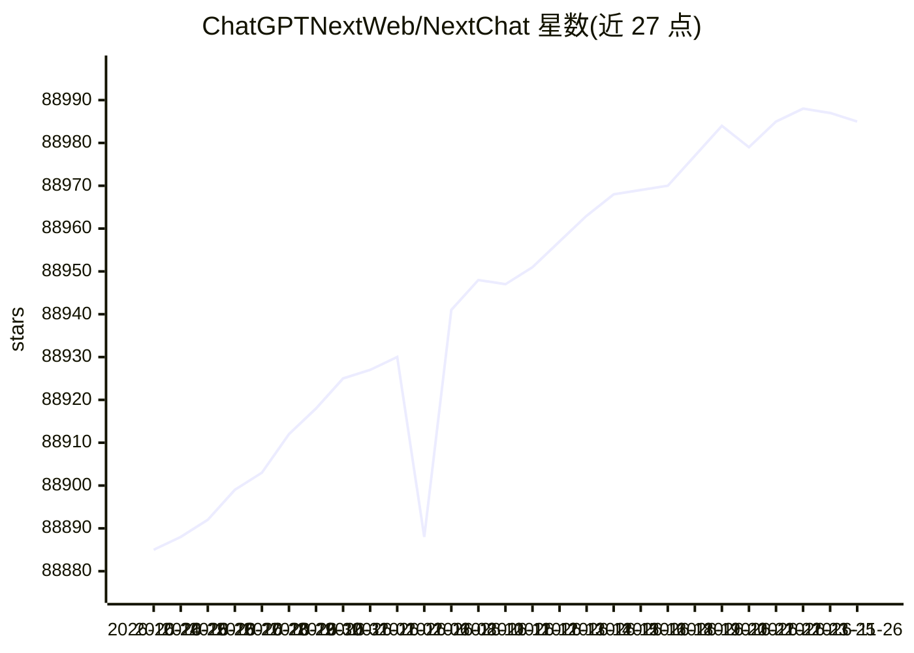

# ChatGPTNextWeb/NextChat

⭐ 88,985 · TypeScript · MIT · 推送 2026-10-20 · [GitHub](https://github.com/ChatGPTNextWeb/NextChat) · [官网](https://nextchat.club) · 组织维护 · 中文 README

**面向个人与团队的多模型 AI 聊天助手，支持一键部署与多端使用**

基于 Next.js 的 AI 聊天前端应用，接入 OpenAI、Azure、Claude、Gemini、DeepSeek、百度、字节、阿里、讯飞、ChatGLM、SiliconFlow、302.AI 等多家服务商 API，并提供 Vercel 一键部署、Docker 部署、桌面客户端（约 5MB）与 iOS 应用。支持 prompt 模板（mask）、聊天历史压缩、Markdown/LaTex/mermaid 渲染、流式响应、WebDAV 聊天记录同步，以及通过 ENABLE_MCP 环境变量启用的 MCP 功能。另提供面向企业私有化定制的商业版咨询渠道。

## 筛选速览

| 维度 | 判定 | 备注 |
|---|---|---|
| AI 角色 | `ai-ecosystem` | LLM/agent 周边工具 |
| 许可风险 | `permissive` | MIT |
| 部署形态 | `self-host` | docker 或自建部署 |
| 模型依赖 | locked-api |  |
| 硬件要求 | — | 无带数字的原话,不猜 |
| 安装摩擦 | `low` | 无编译、无系统依赖或容器化 |
| 成熟度 | — | 结构信号不足 |

## 动量与使用信号

- 维护:`active` — 距上次 push 3.0 天,年发版 0,262 位贡献者
- 涨星:近 1 天 **-2**(自 20261016 起算)
- 下载:GitHub Release 附件 累计 698,515(77 个 release)
- 平台:WINDOWS / MACOS / LINUX / IOS / WEB · 协议:OPENAI-API / MCP

## 能力要点

- 接入 12+ 家模型服务商 API，通过环境变量配置
- 支持 Vercel 一键部署与 Docker 部署
- MCP（Model Context Protocol）功能（ENABLE_MCP=true 启用）
- 兼容自部署 LLM，推荐配合 RWKV-Runner 或 LocalAI

## 适用场景

- 自建一个多模型切换的网页版 AI 聊天界面
- 团队成员共用一个带访问密码控制的聊天入口
- 在桌面/iOS 上使用轻量 AI 聊天客户端

## 场景标签

`聊天机器人` `AI 助手` · 领域:对话与助手

## 证据(README 行号)

> L11: ✨ Light and Fast AI Assistant,with Claude, DeepSeek, GPT4 & Gemini Pro support.
> L69: - Fully compatible with self-deployed LLMs, recommended for use with RWKV-Runner or LocalAI

## 星数曲线

2026-10-24 88,885 → 2026-11-26 88,985（+100）

---
*卡片 v1 · prompt 1.4 · 生成 2026-11-22 · 置信度 high · 依据 README sha `53c001b97486` · [字段定义](../../DATASET.md)*
