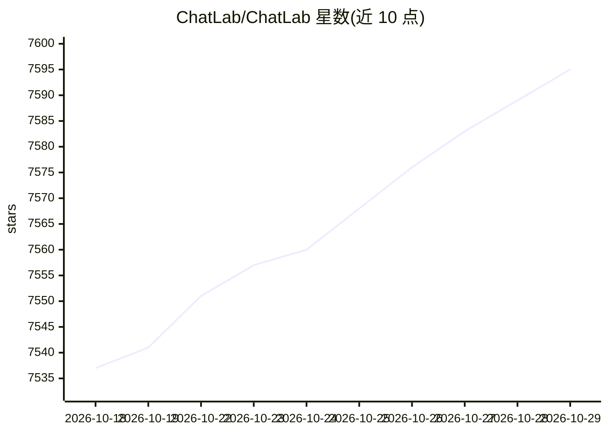

# ChatLab/ChatLab

⭐ 7,595 · TypeScript · AGPL-3.0 · 推送 2026-10-27 · [GitHub](https://github.com/ChatLab/ChatLab) · [官网](https://chatlab.fun) · 组织维护 · 中文 README

**本地优先的桌面聊天记录分析工具，AI 助手辅助挖掘聊天数据**

开源桌面应用（Electron + Vue 3），用于理解社交聊天记录：支持 WhatsApp、LINE、QQ、Discord 等 8 种平台的导出数据，经格式检测、流式解析、本地持久化后，用 SQL 引擎与 AI Agent（24+ 工具的 Function Calling）查询分析，并输出趋势、时间模式、互动频率等可视化视图。数据默认保留在本机，不做强制云上传。提供桌面安装包与 npm CLI（clb web）两种使用方式。

## 筛选速览

| 维度 | 判定 | 备注 |
|---|---|---|
| AI 角色 | `ai-enhanced` | 去掉 AI 部分产品仍成立 |
| 许可风险 | `viral` | AGPL-3.0 |
| 部署形态 | `library` | 以包/库形式分发 |
| 模型依赖 | — | README 未给出锁定关系 |
| 硬件要求 | — | 无带数字的原话,不猜 |
| 安装摩擦 | `low` | 无编译、无系统依赖或容器化 |
| 成熟度 | — | 结构信号不足 |

## 能力要点

- 支持 WhatsApp、LINE、QQ、Discord、Telegram 等 8 种聊天平台数据
- Agent + Function Calling 工作流，24+ 工具搜索/摘要/分析聊天记录
- 流式解析与多 worker 处理，支持百万级消息规模
- 本地优先：原始聊天数据与设置默认保留在设备上

## 适用场景

- 导入多年聊天记录，查看互动趋势与活跃度排行
- 用自然语言让 AI 在自己的聊天数据中搜索和总结
- 跨不同聊天平台统一分析导出的聊天记录

## 场景标签

`数据分析` `AI 助手` · 领域:效率与自动化

## 证据(README 行号)

> L9: ChatLab is an open-source desktop app for understanding your social conversations. It combines a flexible SQL engine
> L19: - 🤖 **AI that can actually operate on data**: Agent + Function Calling workflows (24+ tools) can search, summarize,
> L20: - 📊 **Insight-rich visual views**: See trends, time patterns, interaction frequency, rankings, and more in one plac

## 星数曲线

2026-10-18 7,537 → 2026-10-29 7,595（+58）

---
*卡片 v1 · prompt 1.4 · 生成 2026-10-20 · 置信度 high · 依据 README sha `ae468a60d8b1` · [字段定义](../../DATASET.md)*
