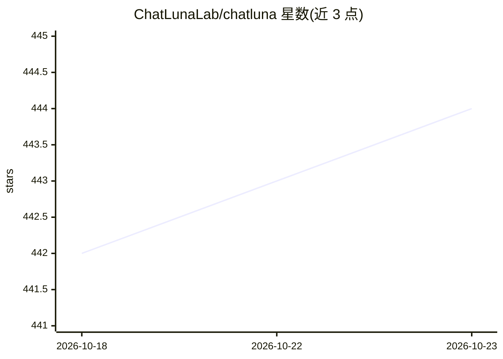

# ChatLunaLab/chatluna

⭐ 444 · TypeScript · AGPL-3.0 · 推送 2026-10-18 · [GitHub](https://github.com/ChatLunaLab/chatluna) · [官网](https://chatluna.chat) · 组织维护 · 中文 README

**Koishi 聊天机器人 LLM 对话插件，多平台模型接入**

基于 LangChain 与 Koishi API 的聊天机器人插件，为 QQ、Telegram 等平台上的机器人提供大语言模型聊天服务。支持聊天、浏览、Agent 三种模式，可自定义 yaml 人格预设，具备上下文感知、长期记忆、速率限制、内容审核与多格式输出（文本、语音、图像、混合）。适配 OpenAI、Azure、Gemini、Claude、Deepseek、通义千问、智谱、Ollama、RWKV 等十余种模型/平台，并为模型提供 Google/Bing/DuckDuckGo/Tavily 网络搜索能力。以 Koishi 插件形式安装，二次开发需克隆并构建。项目自身不提供生成式 AI 服务，需使用者自行获取模型 API。

## 筛选速览

| 维度 | 判定 | 备注 |
|---|---|---|
| AI 角色 | `ai-native` | 本体是模型或模型工具 |
| 许可风险 | `viral` | AGPL-3.0 |
| 部署形态 | `None` |  |
| 模型依赖 | local-ok | 支持本地模型 |
| 硬件要求 | — | 无带数字的原话,不猜 |
| 安装摩擦 | `low` | 无编译、无系统依赖或容器化 |
| 成熟度 | — | 结构信号不足 |

## 能力要点

- 适配十余种模型/平台（OpenAI/Azure/Gemini/Claude/Deepseek/通义千问/Ollama 等）
- 聊天、浏览、Agent 三种模式，支持流式输出与 MCP 协议客户端
- yaml 人格预设系统与长期记忆、上下文感知
- 多格式输出：文本、语音（TTS）、图像渲染、混合

## 适用场景

- 给 QQ/Telegram 群聊机器人接入大语言模型对话
- 通过预设系统自定义机器人人格
- 使用 Agent 模式结合网络搜索回答问题

## 场景标签

`聊天机器人` · 领域:对话与助手

## 证据(README 行号)

> L7: _多平台模型接入，可扩展，多种输出格式，提供大语言模型聊天服务的机器人插件。_
> L25: * 🚀 高度可扩展（基于 LangChain 和 Koishi API）
> L61: |OpenAI|本地 Client，官方 API 接入|可自定义人格，支持 Agent/浏览模式等聊天模式|

## 星数曲线

2026-10-18 442 → 2026-10-23 444（+2）

---
*卡片 v1 · prompt 1.4 · 生成 2026-10-21 · 置信度 high · 依据 README sha `3bee3dbde6bb` · [字段定义](../../DATASET.md)*
