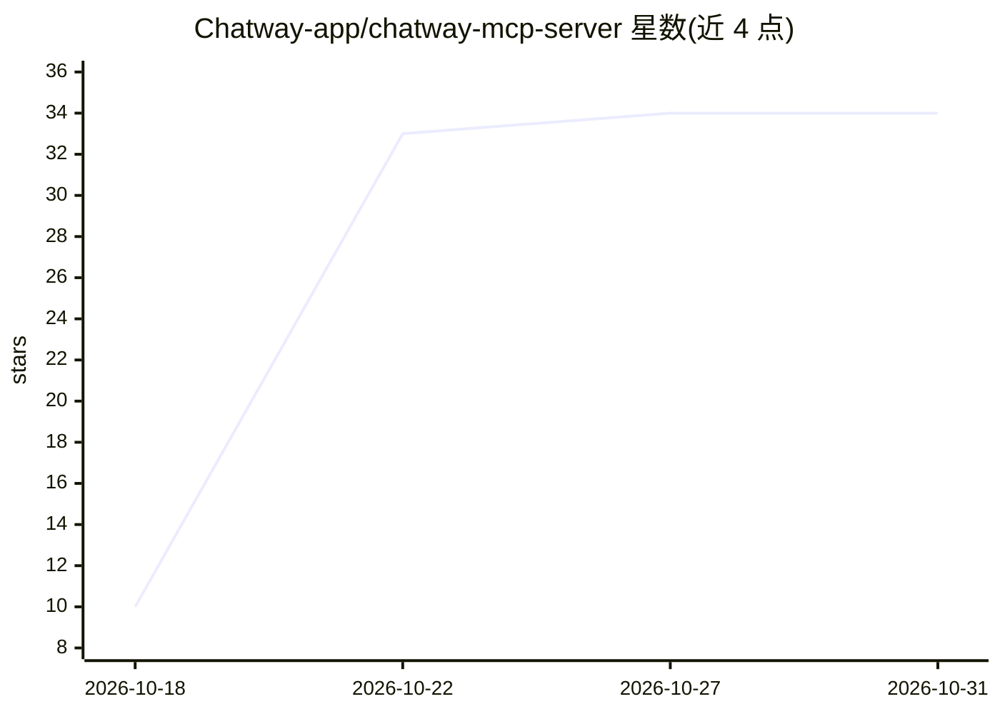

# Chatway-app/chatway-mcp-server

⭐ 34 · MIT · 推送 2026-10-30 · [GitHub](https://github.com/Chatway-app/chatway-mcp-server) · [官网](https://chatway.app/) · 组织维护

**将 AI 助手接入 Chatway 客服系统管理的 MCP 服务器**

Chatway 官方的托管远程 MCP 服务器：让 ChatGPT、Claude、Gemini CLI、Cursor 等 AI 客户端读取和管理 Chatway 在线客服的会话、工单与联系人，支持回复客户、指派人工坐席、添加内部备注、搜索知识库、打标签等操作。认证采用 OAuth 2.1 登录 Chatway 账号，无需 API key，无需本地安装或托管，所有套餐（含免费版）可用（标签与自定义数据工具需付费版）。另提供 5 个 Agent Skills（如支持分诊、回复草稿、智能路由）通过 npx skills 从本仓库安装，以及 webhook 事件触发外部自动化。

## 筛选速览

| 维度 | 判定 | 备注 |
|---|---|---|
| AI 角色 | `ai-ecosystem` | LLM/agent 周边工具 |
| 许可风险 | `permissive` | MIT |
| 部署形态 | `library` | 以包/库形式分发 |
| 模型依赖 | locked-api |  |
| 硬件要求 | — | 无带数字的原话,不猜 |
| 安装摩擦 | `low` | 无编译、无系统依赖或容器化 |
| 成熟度 | — | 结构信号不足 |

## 能力要点

- 托管远程 MCP（Streamable HTTP + OAuth 2.1），无需自托管或 API key
- 会话/回复/指派/联系人/知识库/标签等客服操作工具集
- 5 个 Agent Skills 工作流（分诊、回复助手、智能路由等）
- webhook 事件触发配合 MCP 构建自动客服流程（n8n/Zapier/Make）

## 适用场景

- 让 ChatGPT/Claude 等助手汇总并处理未解决的客服会话
- 自动草拟客户回复并在人工批准后发送
- 结合 webhook 实时触发 AI 代理自动应答客户消息

## 场景标签

`聊天机器人` · 领域:对话与助手

## 证据(README 行号)

> L13: The Chatway MCP server connects AI agents to your Chatway inbox over the
> L20: **Available on every Chatway plan, including Free.** There is nothing to install or host and no

## 星数曲线

2026-10-18 10 → 2026-10-31 34（+24）

---
*卡片 v1 · prompt 1.4 · 生成 2026-10-25 · 置信度 high · 依据 README sha `a9b1e53b8338` · [字段定义](../../DATASET.md)*
