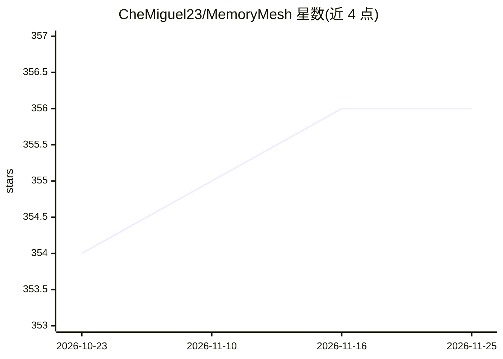

# CheMiguel23/MemoryMesh

⭐ 356 · TypeScript · MIT · 推送 2026-11-14 · [GitHub](https://github.com/CheMiguel23/MemoryMesh) · 个人维护

**为 AI 模型提供知识图谱结构化记忆的 MCP 服务器**

基于 MCP 协议的知识图谱记忆服务器：用户以 .schema.json 模式文件描述要记忆的实体类型，MemoryMesh 为每个模式生成 add/update/delete 三个工具，将信息存为节点与带权重的边，写入操作整体校验（缺失必填字段或不存在的链接则全部拒绝）。内置 read_graph、search_nodes 等通用图操作工具，提供 SchemaManager 可视化编辑与 MemoryViewer 查看器。需要 Node.js 22+ 与 MCP 客户端（如 Claude Desktop），提供 Docker 运行方式。

## 筛选速览

| 维度 | 判定 | 备注 |
|---|---|---|
| AI 角色 | `ai-ecosystem` | LLM/agent 周边工具 |
| 许可风险 | `permissive` | MIT |
| 部署形态 | `self-host` | docker 或自建部署 |
| 模型依赖 | — | README 未给出锁定关系 |
| 硬件要求 | — | 无带数字的原话,不猜 |
| 安装摩擦 | `low` | 无编译、无系统依赖或容器化 |
| 成熟度 | — | 结构信号不足 |

## 能力要点

- 按 schema 文件自动生成 add/update/delete 三类图操作工具
- 写入操作整体校验，失败即全部回滚并返回可操作错误
- 内置 read_graph/search_nodes/open_nodes 等通用图工具
- 支持多 MCP 客户端共享同一记忆文件（文件锁）

## 适用场景

- 为文字 RPG 保存世界观、人物与地点的关系
- 维护个人 CRM：联系人、公司、互动记录
- 管理公司的人员、团队与项目关系
- 记录研究资料与阅读笔记的概念关联

## 场景标签

`知识图谱` `Agent 记忆` · 领域:Agent 开发

## 证据(README 行号)

> L7: MemoryMesh is an MCP server that gives AI models a structured, long-term memory in the form of a knowledge graph. Yo
> L85: You need Node.js 22 or newer and an MCP client such as Claude Desktop.
> L179: |`src/server.ts`|Lists tools and routes each tool call to its handler|

## 星数曲线

2026-10-23 354 → 2026-11-25 356（+2）

---
*卡片 v1 · prompt 1.4 · 生成 2026-11-25 · 置信度 high · 依据 README sha `7acd1e3767e0` · [字段定义](../../DATASET.md)*
