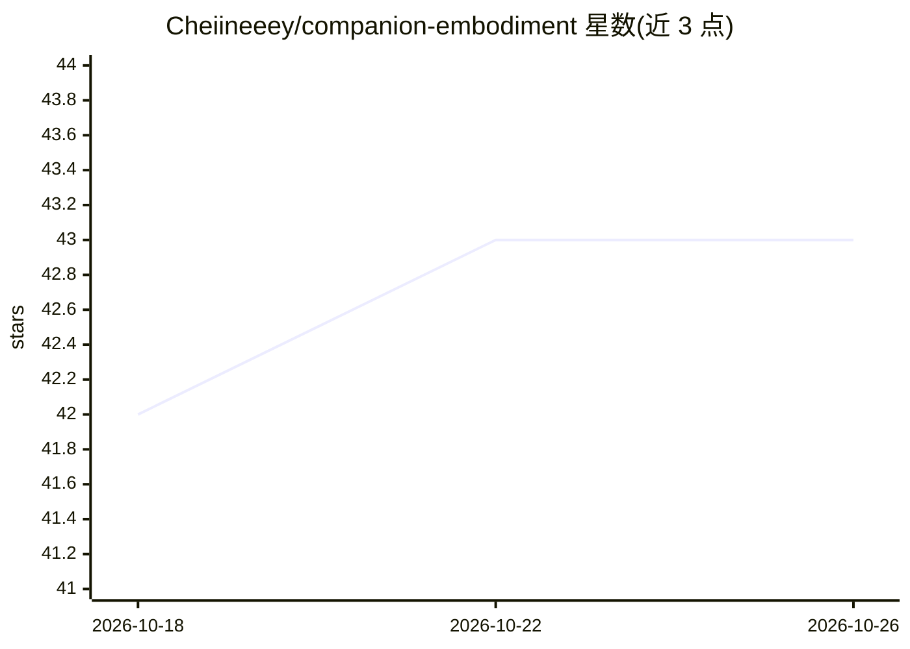

# Cheiineeey/companion-embodiment

⭐ 43 · Python · NOASSERTION · 推送 2026-10-01 · [GitHub](https://github.com/Cheiineeey/companion-embodiment) · 个人维护 · 中文 README

**陪伴型 AI 的动物身体状态机参考实现（默认犬科）**

面向陪伴型对话系统的 Python 参考实现：把事件与情绪先映射为带惯性的内分泌式连续状态，再经胃/胸口/呼吸等内部器官感受的双向回路，输出耳朵、尾巴、爪子、喉咙等身体动作与可选表达提示。另含亲密场景的八状态状态机（idle 至 recovery），采用隐藏标记协议：模型输出标记、服务端独立校验裁决。附带 19 组断言自检与九个踩坑记录。默认参数按犬科调校，换物种需重调动作语义；代码采用 PolyForm Noncommercial 1.0.0 非商业许可。

## 筛选速览

| 维度 | 判定 | 备注 |
|---|---|---|
| AI 角色 | `ai-ecosystem` | LLM/agent 周边工具 |
| 许可风险 | `none` | NOASSERTION |
| 部署形态 | `None` |  |
| 模型依赖 | — | README 未给出锁定关系 |
| 硬件要求 | — | 无带数字的原话,不猜 |
| 安装摩擦 | `low` | 无编译、无系统依赖或容器化 |
| 成熟度 | `idea` | |

## 能力要点

- 事件/情绪 → 内分泌式状态 → 器官感受 → 身体动作的状态链，各状态升降速度不同
- 亲密场景八状态状态机，含隐藏标记协议与服务端二次校验
- 器官与内分泌双向回路：ache 走 bump() 立即生效，敏感度夹紧在 0.7~1.5
- 无第三方库依赖，Python 3.10+ 直接运行，19 组断言自检

## 适用场景

- 为长期陪伴对话角色提供连续一致的身体状态层
- 把身体状态提示接入 LLM 对话循环，让表达携带身体变化
- 参考踩坑记录实现标记解析与服务端校验管道
- 按自身动物物种重调耳朵/尾巴/爪子的动作语义

## 场景标签

`Agent 记忆` · 领域:Agent 开发

## 证据(README 行号)

> L3: 给陪伴型 AI 的动物身体参考：让情绪先经过一副身体，再变成耳朵、尾巴、爪子和说话方式。
> L74: python3 minimal_gateway.py       # 管道：注入 → 生成 → 擦标记 → 服务端裁决 → 痕迹
> L240: 可以把 `prompt_hint` 放进系统上下文，并附上这段约束：

## 星数曲线

2026-10-18 42 → 2026-10-26 43（+1）

---
*卡片 v1 · prompt 1.4 · 生成 2026-10-25 · 置信度 high · 依据 README sha `11d0db68bc32` · [字段定义](../../DATASET.md)*
