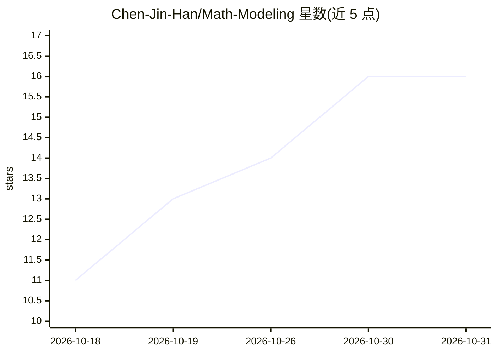

# Chen-Jin-Han/Math-Modeling

⭐ 16 · Python · MIT · 推送 2026-09-28 · [GitHub](https://github.com/Chen-Jin-Han/Math-Modeling) · 个人维护 · 中文 README

**个人数学建模项目与资料库：竞赛论文、代码与模型案例**

面向数学建模学习、竞赛复盘和论文写作的综合资料库，收录个人 2025-2026 年多个竞赛项目成果（含 MATLAB/Python 可运行支撑代码）、历年赛题、优秀论文集（含按 20/36/40 类模型整理的论文库、4691 个文件的往届优秀论文）、写作模板与优化理论参考书，并聚合 9 个第三方数学建模 Skills 项目的完整源码。每个顶层目录配独立 README，项目采用题目/论文/补充材料三目录统一结构，代码需自行复现运行。

## 筛选速览

| 维度 | 判定 | 备注 |
|---|---|---|
| AI 角色 | `ai-knowledge` | 知识聚合/清单类 |
| 许可风险 | `permissive` | MIT |
| 部署形态 | `None` |  |
| 模型依赖 | — | README 未给出锁定关系 |
| 硬件要求 | — | 无带数字的原话,不猜 |
| 安装摩擦 | `low` | 无编译、无系统依赖或容器化 |
| 成熟度 | — | 结构信号不足 |

## 能力要点

- 收录 8 个个人竞赛项目成果与 MATLAB/Python 支撑代码
- 论文库按模型类别组织：20 类 201 篇、36 类 312 篇、40 类 1069 篇 PDF
- 聚合 9 个第三方数学建模 Skills 项目源码并保留原许可
- 提供复盘路径与按模型（评价/预测/优化/机器学习/机理仿真）查案例的索引

## 适用场景

- 竞赛前按模型类别检索往届论文与适用条件
- 复盘竞赛题并复现实验代码
- 学习数学建模论文结构与写作模板
- 获取 AHP、遗传算法、神经网络等常用模型的实现案例

## 场景标签

`教程课程` `精选清单` · 领域:学习与行业

## 证据(README 行号)

> L10: 这是一个面向数学建模学习、竞赛复盘和论文写作的综合资料库，收录个人项目成果、可复现实验代码、历年赛题、优秀论文、常用模型案例、写作模板与理论参考资料。每个顶层目录均配有独立 README，用于说明研究主题、文件结构、运行条件和材料
> L39: |资料库|规模|主要用途|

## 星数曲线

2026-10-18 11 → 2026-10-31 16（+5）

---
*卡片 v1 · prompt 1.4 · 生成 2026-10-30 · 置信度 high · 依据 README sha `088bcafc407e` · [字段定义](../../DATASET.md)*
