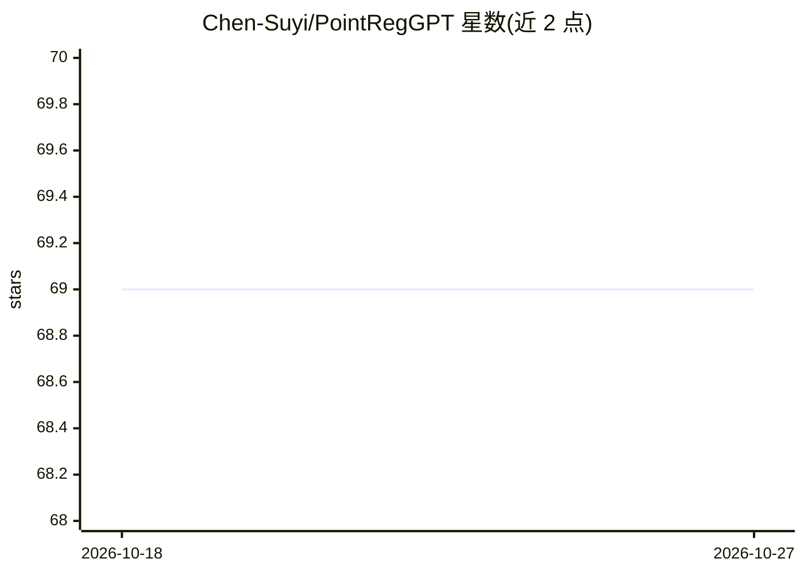

# Chen-Suyi/PointRegGPT

⭐ 69 · Python · Apache-2.0 · 推送 2026-02-24 · [GitHub](https://github.com/Chen-Suyi/PointRegGPT) · 个人维护

**用生成式点云对增强 3D 点云配准训练的 ECCV 2024 方法（PyTorch 实现）**

ECCV 2024 论文 PointRegGPT 的 PyTorch 实现：从单张深度图出发，施加随机相机运动重投影得到目标深度图并构造点云训练对，用深度修复扩散模型提升数据真实性，并以深度校正模块缓解重投影中的穿透伪影。面向 3D 点云配准方向的研究者，提供生成数据脚本、扩散模型与深度校正模块的训练/测试流程、3DMatch 数据准备说明及预训练权重，并为 PREDOTOR/CoFiNet/GeoTransformer 基线提供数据加载示例。

## 筛选速览

| 维度 | 判定 | 备注 |
|---|---|---|
| AI 角色 | `ai-native` | 本体是模型或模型工具 |
| 许可风险 | `permissive` | Apache-2.0 |
| 部署形态 | `desktop` | 安装包/桌面程序 |
| 模型依赖 | — | README 未给出锁定关系 |
| 硬件要求 | — | 无带数字的原话,不猜 |
| 安装摩擦 | `low` | 无编译、无系统依赖或容器化 |
| 成熟度 | — | 结构信号不足 |

## 能力要点

- 随机相机运动重投影 + 深度修复扩散模型生成点云配准训练对
- 深度校正模块处理重投影穿透伪影
- 提供扩散模型与深度校正模块的训练、测试脚本及预训练权重
- 为 PREDATOR/CoFiNet/GeoTransformer 提供生成数据加载示例与基线权重

## 适用场景

- 为点云配准模型生成额外训练数据
- 复现或扩展 ECCV 2024 PointRegGPT 实验
- 在 3DMatch 基准上训练/评测配准方法

## 场景标签

 · 领域:3D 视觉/点云配准

## 证据(README 行号)

> L7: In this work, we present PointRegGPT, boosting 3D point cloud registration using generative point-cloud pairs for tr
> L9: To enhance the data realism, we formulate a generative model as a depth inpainting diffusion to process the target d

## 星数曲线

2026-10-18 69 → 2026-10-27 69（+0）

---
*卡片 v1 · prompt 1.4 · 生成 2026-10-24 · 置信度 high · 依据 README sha `9527ebbddf24` · [字段定义](../../DATASET.md)*
