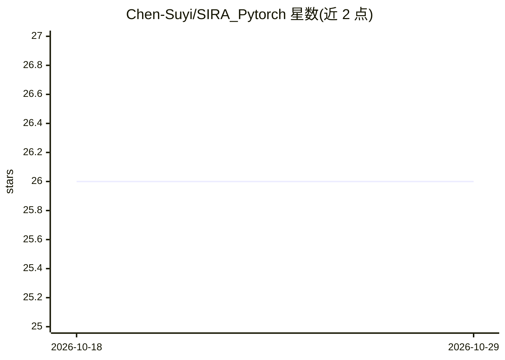

# Chen-Suyi/SIRA_Pytorch

⭐ 26 · Python · Apache-2.0 · 推送 2026-02-24 · [GitHub](https://github.com/Chen-Suyi/SIRA_Pytorch) · 个人维护

**ICCV 2023 论文 SIRA-PCR 的 PyTorch 实现：3D 点云配准的仿真到现实自适应**

论文官方代码库，包含两部分：SIRA 仿真到现实自适应模块（含自适应重采样，模拟真实点云模式）与点云配准模型（GeoTransformer 结构）。提供 FlyingShapes/Structured3D/3DMatch 等数据准备流程、预训练权重、适配处理、训练与微调、3DMatch/3DLoMatch/ETH 基准测试的完整命令。训练与测试命令通过 CUDA_VISIBLE_DEVICES 指定 GPU。面向复现实验或开展点云配准研究的科研用户，数据需自行下载并按指定目录结构组织。

## 筛选速览

| 维度 | 判定 | 备注 |
|---|---|---|
| AI 角色 | `ai-native` | 本体是模型或模型工具 |
| 许可风险 | `permissive` | Apache-2.0 |
| 部署形态 | `desktop` | 安装包/桌面程序 |
| 模型依赖 | — | README 未给出锁定关系 |
| 硬件要求 | — | 无带数字的原话,不猜 |
| 安装摩擦 | `low` | 无编译、无系统依赖或容器化 |
| 成熟度 | — | 结构信号不足 |

## 能力要点

- SIRA 仿真到现实自适应框架（自适应重采样模块）
- 配套合成场景级 3D 配准数据集 FlyingShapes 与 SIRA 数据
- 提供预训练权重及 3DMatch/3DLoMatch/ETH 基准测试脚本

## 适用场景

- 复现 ICCV 2023 论文的点云配准实验
- 在合成数据上训练配准模型并微调到真实场景数据
- 研究点云配准的仿真到现实迁移方法

## 场景标签

`科研工具` · 领域:学习与行业

## 证据(README 行号)

> L3: This is the Pytorch implementation of our ICCV2023 paper SIRA-PCR.
> L13: To our best knowledge, this is the first work that explores sim-to-real adaptation for point cloud registration.

## 星数曲线

2026-10-18 26 → 2026-10-29 26（+0）

---
*卡片 v1 · prompt 1.4 · 生成 2026-10-26 · 置信度 high · 依据 README sha `4824cc5b9501` · [字段定义](../../DATASET.md)*
