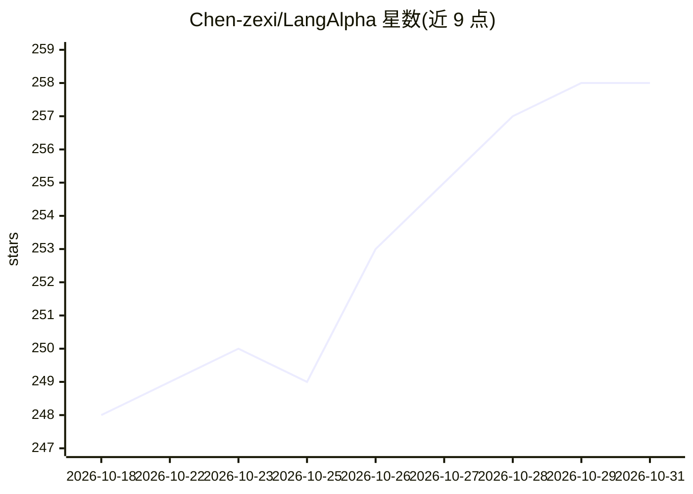

# Chen-zexi/LangAlpha

⭐ 258 · Jupyter Notebook · 推送 2026-10-05 · [GitHub](https://github.com/Chen-zexi/LangAlpha) · [官网](https://langalpha.ai) · 个人维护

**面向美股研究的多智能体金融分析系统，生成 Markdown 研究报告**

基于 LangChain/LangGraph 构建的多智能体金融研究工作流：接受自然语言查询，由 supervisor 统筹 planner、researcher、market、browser、coder、analyst、reporter 等角色，从 Polygon、Yahoo Finance、Tavily、Tickertick 等来源采集新闻、行情与基本面数据，经分析合成后输出结构化 Markdown 报告。附带 Damodaran 估值模型与交易策略 notebook。单次生成约需 2-6 分钟、30000+ 至 100000+ token。范围限定美股，不提供实时交易建议；Web UI 中 browser agent 不可用。提供 Docker Compose 部署方式（含 web 与 MongoDB 服务），README 自称早期探索与概念验证。

## 筛选速览

| 维度 | 判定 | 备注 |
|---|---|---|
| AI 角色 | `ai-native` | 本体是模型或模型工具 |
| 许可风险 | `none` | — |
| 部署形态 | `self-host` | docker 或自建部署 |
| 模型依赖 | — | README 未给出锁定关系 |
| 硬件要求 | — | 无带数字的原话,不猜 |
| 安装摩擦 | `low` | 无编译、无系统依赖或容器化 |
| 成熟度 | `idea` | |

## 能力要点

- LangGraph 多智能体编排：supervisor/planner/researcher/market/coder/analyst/reporter 分工协作
- 接入 Polygon、Yahoo Finance、Alpha Vantage、Tavily、Tickertick 等多源数据
- Damodaran 方法启发的估值模型与交易策略 notebook
- Docker Compose 一键部署，含 Web UI 与 MongoDB 存储

## 适用场景

- 用自然语言查询生成美股/行业的研究分析报告
- 获取结合新闻与量化数据的技术面/基本面综合分析
- 运行 Damodaran 启发的估值模型做手动输入估值

## 场景标签

`多智能体` `金融量化` · 领域:Agent 开发

## 证据(README 行号)

> L22: The primary functionality is delivered through a sophisticated **multi-agent system** built with **LangGraph**, loc
> L26: 1. **User Query:** The system accepts natural language queries about financial markets, stocks, or economic events.
> L38:  * Finally, a `reporter` agent compiles all the validated information and analysis into a comprehensive, well-struc

## 星数曲线

2026-10-18 248 → 2026-10-31 258（+10）

---
*卡片 v1 · prompt 1.4 · 生成 2026-10-22 · 置信度 high · 依据 README sha `a3c8396c669e` · [字段定义](../../DATASET.md)*
