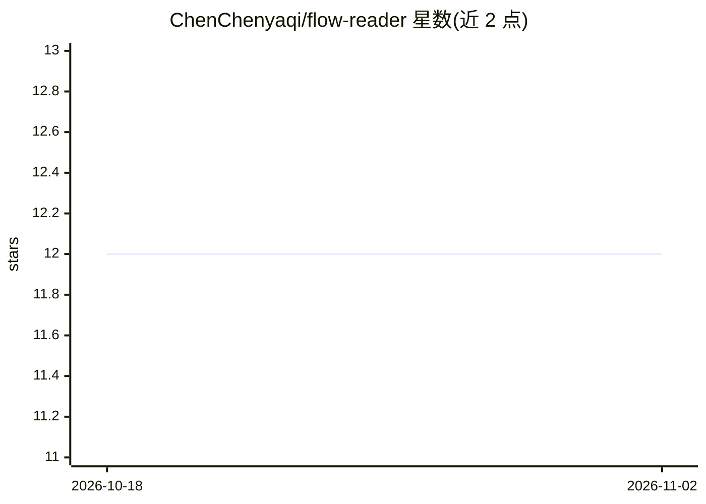

# ChenChenyaqi/flow-reader

⭐ 12 · TypeScript · AGPL-3.0 · 推送 2026-02-16 · [GitHub](https://github.com/ChenChenyaqi/flow-reader) · 个人维护 · 中文 README

**网页划词 AI 英语学习浏览器扩展（A1-B2）**

面向开发者与英语学习者（A1-B2）的开源浏览器扩展：在任意网页选中文本后调用 LLM 进行句子简化（打字机流式输出）、语法主谓宾可视化高亮、按 CEFR 级别（500~8000 词）筛选词汇并给出英文释义与中文翻译，支持标记生词。纯前端架构，BYOK 模式接入智谱 GLM-4.7、OpenAI 或任意 OpenAI 格式 API（如 DeepSeek、本地 LLM），API Key 与阅读数据仅存本地。通过 Chrome/Edge 加载解压扩展或从商店安装（商店上架标注 coming soon）。

## 筛选速览

| 维度 | 判定 | 备注 |
|---|---|---|
| AI 角色 | `ai-native` | 本体是模型或模型工具 |
| 许可风险 | `viral` | AGPL-3.0 |
| 部署形态 | `None` |  |
| 模型依赖 | — | README 未给出锁定关系 |
| 硬件要求 | — | 无带数字的原话,不猜 |
| 安装摩擦 | `low` | 无编译、无系统依赖或容器化 |
| 成熟度 | — | 结构信号不足 |

## 能力要点

- 选中网页文本即触发 AI 分析（简化/语法可视化/词汇解释）
- 按 CEFR 级别筛选词汇并记忆已掌握单词
- BYOK 多模型支持：智谱 GLM-4.7、OpenAI、自定义 OpenAI 格式端点
- 纯前端应用，API Key 与阅读数据本地存储

## 适用场景

- 阅读英文网页时划词查看简化句与语法结构
- 按自己水平积累和管理英语生词
- 在国内网络环境下用智谱 API 使用扩展

## 场景标签

 · 领域:语言学习/浏览器工具

## 证据(README 行号)

> L19: **FlowReader** is an open-source browser extension designed for developers and English learners (A1-B2). It uses AI
> L32: - **🤖 Multi-Model Support**: Supports **Zhipu AI** (GLM-4.7), **OpenAI**, and custom API endpoints.

## 星数曲线

2026-10-18 12 → 2026-11-02 12（+0）

---
*卡片 v1 · prompt 1.4 · 生成 2026-11-01 · 置信度 high · 依据 README sha `24f697707b49` · [字段定义](../../DATASET.md)*
