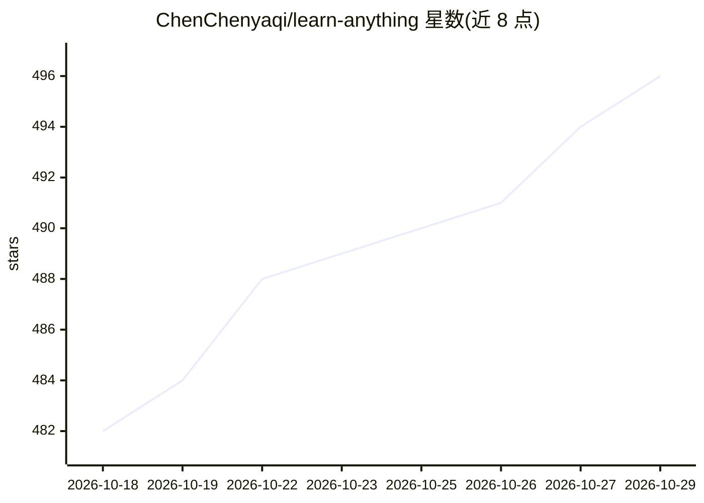

# ChenChenyaqi/learn-anything

⭐ 496 · TypeScript · MIT · 推送 2026-08-29 · [GitHub](https://github.com/ChenChenyaqi/learn-anything) · 个人维护 · 中文 README

**为 30+ AI 编码工具生成苏格拉底式学习命令的 CLI**

面向使用 AI 编码助手的开发者与学习者的 npm CLI：通过适配器模式为 Claude Code、Cursor、Codex 等 30+ 工具生成各自格式的技能与命令文件（Claude 用 YAML frontmatter、Gemini 用 TOML、Cursor 用 Markdown 等），装好后 AI 助手获得 /learn:topic、/learn:explain 等 6 条学习命令，覆盖知识图谱、递归讲解、TDD 式练习、测验与间隔复习。附带零配置可视化 Web 仪表盘，支持中英双语界面。可选集成 Context7 做文档核验。开发需 Node.js≥20 与 pnpm≥9。

## 筛选速览

| 维度 | 判定 | 备注 |
|---|---|---|
| AI 角色 | `ai-ecosystem` | LLM/agent 周边工具 |
| 许可风险 | `permissive` | MIT |
| 部署形态 | `library` | 以包/库形式分发 |
| 模型依赖 | locked-api |  |
| 硬件要求 | — | 无带数字的原话,不猜 |
| 安装摩擦 | `low` | 无编译、无系统依赖或容器化 |
| 成熟度 | `idea` | |

## 能力要点

- 适配器模式为 30+ AI 编码工具生成对应格式的技能/命令文件
- 6 条学习命令：知识图谱、递归讲解、TDD 练习、测验、间隔复习、状态热图
- 内置零配置可视化仪表盘（知识地图、会话笔记、练习查看器、i18n）
- 可选集成 Context7 对官方文档交叉核验讲解内容

## 适用场景

- 在我的 Claude Code/Cursor 里添加一套交互式学习命令来系统学某个技术主题
- 通过 TDD 式练习和间隔复习巩固编程技能
- 用可视化仪表盘浏览学习进度与会话笔记

## 场景标签

`教程课程` · 领域:学习与行业

## 证据(README 行号)

> L18: **Learn Anything** generates skill and command files for **30+ AI coding tools** — Claude Code, Cursor, Codex, Open
> L86: Each AI tool receives **tool-appropriate file formats** via an adapter pattern — YAML frontmatter for Claude, TOML 

## 星数曲线

2026-10-18 482 → 2026-10-29 496（+14）

---
*卡片 v1 · prompt 1.4 · 生成 2026-10-21 · 置信度 high · 依据 README sha `e183dc164094` · [字段定义](../../DATASET.md)*
