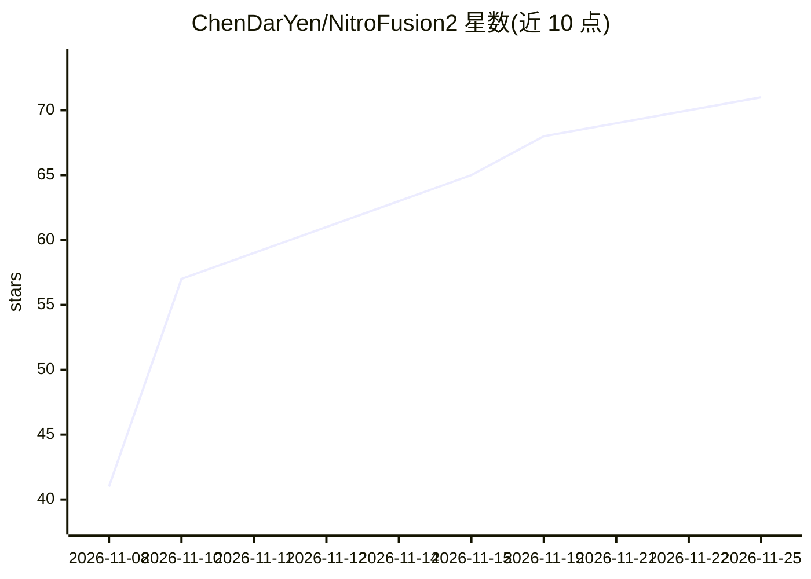

# ChenDarYen/NitroFusion2

⭐ 71 · Python · Apache-2.0 · 推送 2026-11-13 · [GitHub](https://github.com/ChenDarYen/NitroFusion2) · [官网](https://chendaryen.github.io/NitroFusion2.github.io/) · 组织维护

**1–2 步文生图扩散模型，将对抗损失施加于 MMDiT 文本流**

基于 Z-Image-Turbo 的 1–2 步文生图模型与配套研究方法：将对抗蒸馏损失放在 MMDiT 的文本 token 流上，使文本表示成为可引导的判别器（排版/物体/风格线索切换批评对象），一步即可渲染清晰文字与细节。以 Hugging Face checkpoint 发布，提供 ComfyUI 工作流（含 GGUF 量化档位 Q2_K 至 Q8_0）、diffusers 推理脚本与在线 demo，另发布支持 Canny/HED/Depth/Pose/Gray/修复的 Union ControlNet 及去蒸馏 LoRA。附带 arXiv 论文。

## 筛选速览

| 维度 | 判定 | 备注 |
|---|---|---|
| AI 角色 | `ai-native` | 本体是模型或模型工具 |
| 许可风险 | `permissive` | Apache-2.0 |
| 部署形态 | `None` |  |
| 模型依赖 | — | README 未给出锁定关系 |
| 硬件要求 | — | 无带数字的原话,不猜 |
| 安装摩擦 | `low` | 无编译、无系统依赖或容器化 |
| 成熟度 | — | 结构信号不足 |

## 能力要点

- 1–2 步生成，一步可渲染清晰文字与细节
- 对抗损失施加于 MMDiT 文本流，单一冻结判别器可按线索切换
- GGUF 量化档位从 2.0 GB（Q2_K）到 7.2 GB（Q8_0）
- Union ControlNet 覆盖 Canny/HED/Depth/Pose/Gray/修复六种控制

## 适用场景

- 用 ComfyUI 或 diffusers 做少步文生图推理
- 生成含文字排版的图像
- 通过 ControlNet 做边缘/深度/姿态等条件控制生成

## 场景标签

`图像生成` · 领域:内容生成

## 证据(README 行号)

> L18: NitroFusion2 is a 1–2 step text-to-image model built on Z-Image-Turbo. It moves the adversarial loss onto the text 
> L58: In an MMDiT, text and image tokens move through the same attention layers, so by the middle of the network the text

## 星数曲线

2026-11-08 41 → 2026-11-25 71（+30）

---
*卡片 v1 · prompt 1.4 · 生成 2026-11-18 · 置信度 high · 依据 README sha `3ad63992cca2` · [字段定义](../../DATASET.md)*
