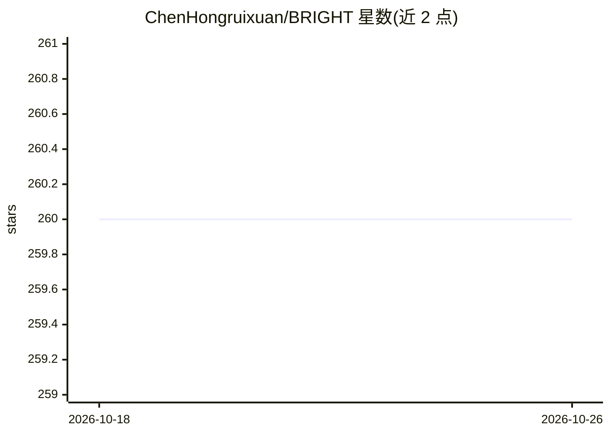

# ChenHongruixuan/BRIGHT

⭐ 260 · Python · Apache-2.0 · 推送 2026-07-21 · [GitHub](https://github.com/ChenHongruixuan/BRIGHT) · [官网](https://essd.copernicus.org/articles/17/6217/2025/essd-17-6217-2025.html) · 组织维护

**全球分布多模态 VHR 灾害响应数据集与基准代码**

面向 AI 灾害响应的开放数据集：覆盖 5 类自然灾害与 2 类人为灾害、14 个灾害事件、全球 23 个地区，提供光学与 SAR 多模态甚高分辨率影像及建筑损毁标注，重点关注发展中国家。配套基准代码支持监督学习、跨事件迁移、无监督域适应、半监督学习、无监督变化检测与图像匹配等评估设置，并提供 UNet 训练/推理脚本与 Zenodo 检查点。代码在 Linux 下运行，经 conda+pip 安装；部分乌克兰、缅甸、墨西哥光学数据不可再分发，需按教程自行下载。已被 ESSD 接收，并支撑 IEEE GRSS DFC 2025 与 CVPRW 2026 挑战赛。

## 筛选速览

| 维度 | 判定 | 备注 |
|---|---|---|
| AI 角色 | `ai-knowledge` | 知识聚合/清单类 |
| 许可风险 | `permissive` | Apache-2.0 |
| 部署形态 | `library` | 以包/库形式分发 |
| 模型依赖 | — | README 未给出锁定关系 |
| 硬件要求 | — | 无带数字的原话,不猜 |
| 安装摩擦 | `low` | 无编译、无系统依赖或容器化 |
| 成熟度 | — | 结构信号不足 |

## 能力要点

- 覆盖 14 个灾害事件、23 个地区的光学与 SAR 多模态 VHR 数据
- 提供监督、跨事件迁移、UDA、半监督、无监督变化检测与图像匹配等标准化基准
- UNet 训练/推理脚本与可下载检查点
- 支撑 IEEE GRSS DFC 2025 Track II 与 CVPRW 2026 实例级挑战赛

## 适用场景

- 训练与评估多模态建筑损毁评估模型
- 测试模型在未见灾害事件上的跨事件泛化能力
- 参加或复现 DFC 2025 / CVPRW 2026 灾害制图挑战赛
- 研究无监督多模态变化检测与光学-SAR 图像配准

## 场景标签

`多模态` `目标检测` `模型评测` · 领域:评测与运维

## 证据(README 行号)

> L28: * **BRIGHT** is the first open-access, globally distributed, event-diverse multimodal dataset specifically curated 
> L30: * It supports not only the development of **supervised** deep models, but also the testing of their performance on 

## 星数曲线

2026-10-18 260 → 2026-10-26 260（+0）

---
*卡片 v1 · prompt 1.4 · 生成 2026-10-22 · 置信度 mid · 依据 README sha `ec75bda4d22e` · [字段定义](../../DATASET.md)*
