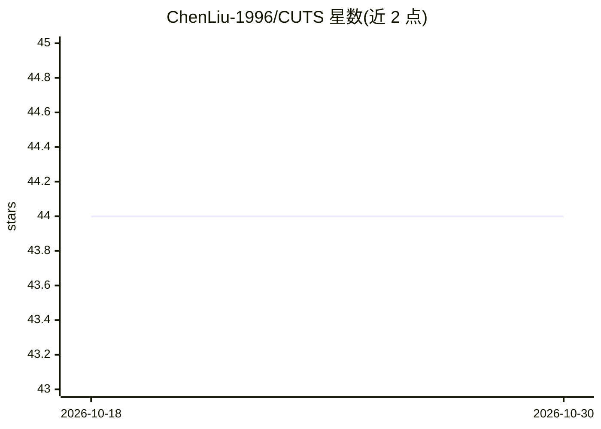

# ChenLiu-1996/CUTS

⭐ 44 · Python · NOASSERTION · 推送 2026-05-02 · [GitHub](https://github.com/ChenLiu-1996/CUTS) · [官网](https://arxiv.org/abs/2209.11359) · 组织维护

**多粒度无监督医学图像分割的 PyTorch 框架（MICCAI 2024）**

Krishnaswamy Lab（Yale）发布的 CUTS 官方 PyTorch 实现，MICCAI 2024 论文配套代码：通过卷积编码器自监督训练与拓扑方法（diffusion condensation、spectral k-means）生成多尺度无监督分割，无需标注标签。仓库内置 berkeley_natural_images、brain_tumor、retina 数据集，brain_ventricles 需从 Google Drive/HuggingFace 获取；支持自定义数据集（含无标签路径与伪标签生成二值 mask），并附 STEGO/DFC/SAM/MedSAM/SAM-Med2D 对比脚本与论文图表复现脚本。Python 3.9 + PyTorch 1.12.1 conda 环境，安装约需 20 分钟至 1 小时。

## 筛选速览

| 维度 | 判定 | 备注 |
|---|---|---|
| AI 角色 | `ai-native` | 本体是模型或模型工具 |
| 许可风险 | `none` | NOASSERTION |
| 部署形态 | `None` |  |
| 模型依赖 | — | README 未给出锁定关系 |
| 硬件要求 | — | 无带数字的原话,不猜 |
| 安装摩擦 | `low` | 无编译、无系统依赖或容器化 |
| 成熟度 | — | 结构信号不足 |

## 能力要点

- 完全无监督的多粒度医学图像分割（编码器训练 + diffusion condensation）
- 内置三个预处理数据集，HuggingFace 提供完整数据下载
- 支持自定义数据集（有标签/无标签/伪标签三种路径）
- 附带 STEGO、DFC、SAM、MedSAM、SAM-Med2D 对比实验脚本

## 适用场景

- 复现 MICCAI 2024 论文中的分割结果与图表
- 在自己的医学影像数据上做无标注多尺度分割
- 与 SAM/MedSAM 等方法进行无监督分割对比实验

## 场景标签

`目标检测` · 领域:感知与多模态

## 证据(README 行号)

> L18: This is the authors' PyTorch implementation of **CUTS**, MICCAI 2024.
> L3:  A Deep Learning and Topological Framework for Multigranular Unsupervised Medical Image Segmentation

## 星数曲线

2026-10-18 44 → 2026-10-30 44（+0）

---
*卡片 v1 · prompt 1.4 · 生成 2026-10-25 · 置信度 high · 依据 README sha `4bc00037178c` · [字段定义](../../DATASET.md)*
