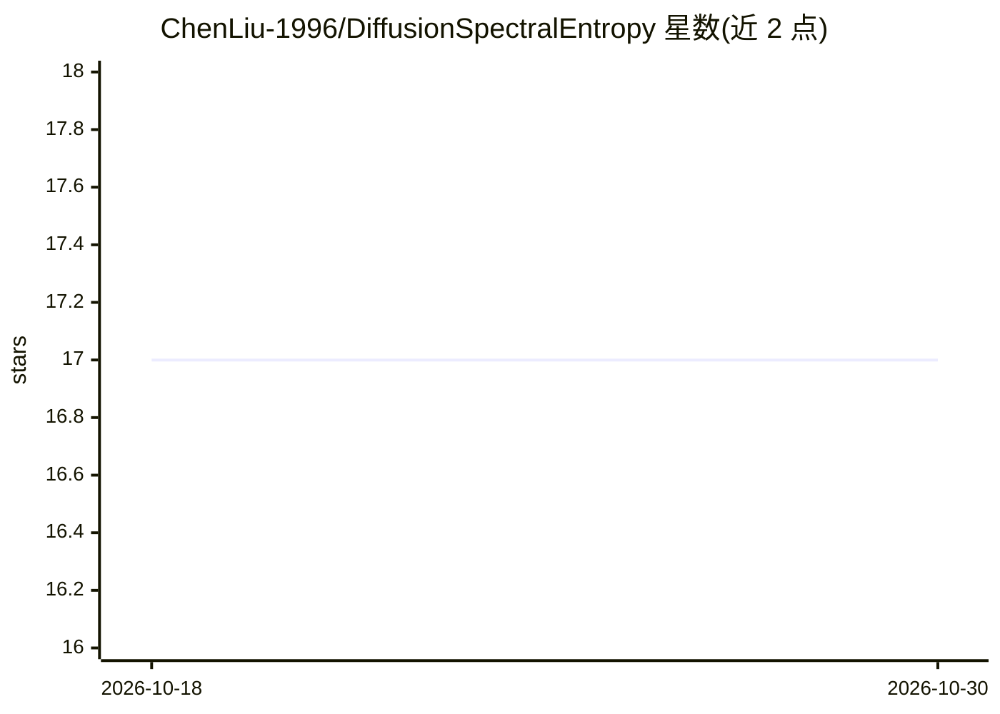

# ChenLiu-1996/DiffusionSpectralEntropy

⭐ 17 · Python · NOASSERTION · 推送 2026-02-14 · [GitHub](https://github.com/ChenLiu-1996/DiffusionSpectralEntropy) · [官网](https://arxiv.org/abs/2312.04823) · 组织维护

**测量神经网络表征熵与互信息的科研库（DSE/DSMI）**

Krishnaswamy Lab（耶鲁）发表的 ICMLW 2023/IEEE CISS 2024 论文官方实现：基于数据图的扩散矩阵计算扩散谱熵（DSE）与扩散谱互信息（DSMI），用于测量神经网络特定层表征的熵及与输入/输出变量的互信息，不依赖分箱、避免维数灾难，可应用于 ResNet-50 等现代网络。面向深度学习理论研究者，支持训练动态可视化、初始化选择与跨模型相关性分析。注意：因内部政策已移除完整代码库，仅公开 DSE/DSMI 函数与论文复现内容已删除；测试环境为 Python 3.9.13 + PyTorch 1.12.1。

## 筛选速览

| 维度 | 判定 | 备注 |
|---|---|---|
| AI 角色 | `ai-ecosystem` | LLM/agent 周边工具 |
| 许可风险 | `none` | NOASSERTION |
| 部署形态 | `library` | 以包/库形式分发 |
| 模型依赖 | — | README 未给出锁定关系 |
| 硬件要求 | — | 无带数字的原话,不猜 |
| 安装摩擦 | `low` | 无编译、无系统依赖或容器化 |
| 成熟度 | — | 结构信号不足 |

## 能力要点

- 从数据图扩散矩阵计算 DSE/DSMI，无分箱、避免维数灾难
- 可测量神经网络指定层表征的熵及其与输入/输出的互信息
- 提供 pip 安装包 dse-dsmi 与内置单元测试
- 官方实现，但完整代码库因内部政策移除，仅保留核心函数

## 适用场景

- 可视化分类网络训练过程中的表征动态
- 用 DSE 指导卷积层初始化参数选择
- 用 DSMI 跨预训练模型评估，为特定数据集预筛候选模型

## 场景标签

`科研工具` · 领域:学习与行业

## 证据(README 行号)

> L20: This is the **official** implementation of
> L22: **Assessing Neural Network Representations During Training Using Noise-Resilient Diffusion Spectral Entropy**
> L96: We can measure, with respect to a given set of data samples, (1) the entropy of the neural representation at a spec
> L104: Conceptually, we build a data graph from the neural network representations of all data points in a dataset, and c

## 星数曲线

2026-10-18 17 → 2026-10-30 17（+0）

---
*卡片 v1 · prompt 1.4 · 生成 2026-10-30 · 置信度 high · 依据 README sha `1f007eaadb8c` · [字段定义](../../DATASET.md)*
