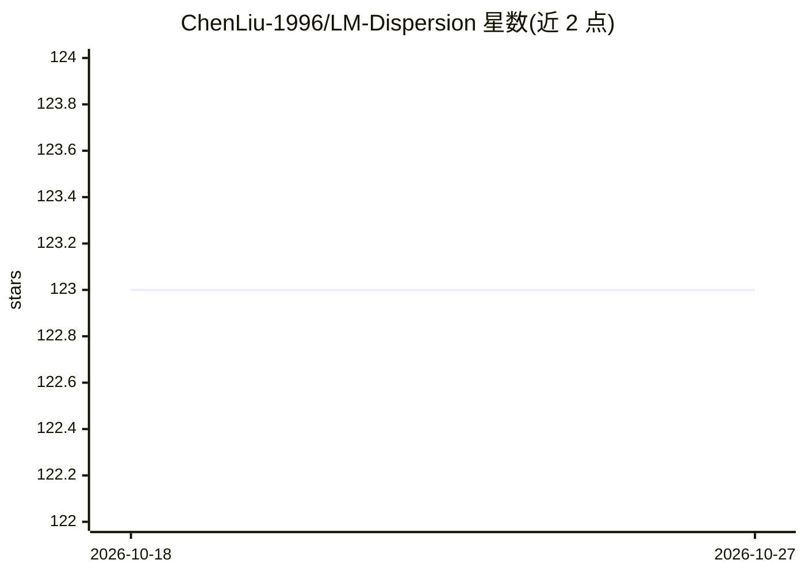

# ChenLiu-1996/LM-Dispersion

⭐ 123 · Python · NOASSERTION · 推送 2026-06-21 · [GitHub](https://github.com/ChenLiu-1996/LM-Dispersion) · [官网](https://chenliu-1996.github.io/projects/LM-Dispersion/) · 个人维护

**ICML 2026 论文官方代码：embedding 凝聚现象观测与 dispersion loss 训练目标**

作者仓库，配套 ICML 2026 论文：观测小语言模型中 token embedding 塌缩到窄锥形子空间的现象（embedding condensation），并提出 dispersion loss 在预训练/中期训练中抵消该效应。提供计算与可视化 embedding 凝聚程度的 PyPI 包（传入 transformers 模型即可），并附论文结果复现脚本：对 GPT2/Qwen/BLOOM 等模型族计算余弦相似度趋势、基于 accelerate 的 GPT2 中期训练实验（默认 loss、dispersion loss、基线方法）、基于 Torch Titan 的预训练。依赖 miniconda 环境。

## 筛选速览

| 维度 | 判定 | 备注 |
|---|---|---|
| AI 角色 | `ai-native` | 本体是模型或模型工具 |
| 许可风险 | `none` | NOASSERTION |
| 部署形态 | `library` | 以包/库形式分发 |
| 模型依赖 | — | README 未给出锁定关系 |
| 硬件要求 | — | 无带数字的原话,不猜 |
| 安装摩擦 | `medium` | 含编译或系统依赖之一 |
| 成熟度 | — | 结构信号不足 |

## 能力要点

- PyPI 包 embedding-condensation 计算/可视化 embedding 凝聚，支持 wikipedia/pubmed/imdb/squad 数据集
- dispersion loss 训练目标（angular_spread 等模式）用于中期训练与预训练
- 覆盖 GPT2/Qwen1/Qwen2.5/Qwen3/BLOOM 等模型族的观测复现脚本

## 适用场景

- 我想测量自己语言模型的 embedding 凝聚程度
- 复现论文中 dispersion loss 的中期训练与预训练实验
- 比较不同规模模型的 embedding 几何特性

## 场景标签

`模型训练` · 领域:训练与推理

## 证据(README 行号)

> L24: This is the author's repository for the ICML 2026 paper
> L35: We observe a geometric phenomenon which we term **embedding condensation**, where token embeddings collapse into a 
> L63: We now provide the computation and visualization of embedding condensation via a PyPI package!

## 星数曲线

2026-10-18 123 → 2026-10-27 123（+0）

---
*卡片 v1 · prompt 1.4 · 生成 2026-10-23 · 置信度 high · 依据 README sha `3b07f048b2eb` · [字段定义](../../DATASET.md)*
