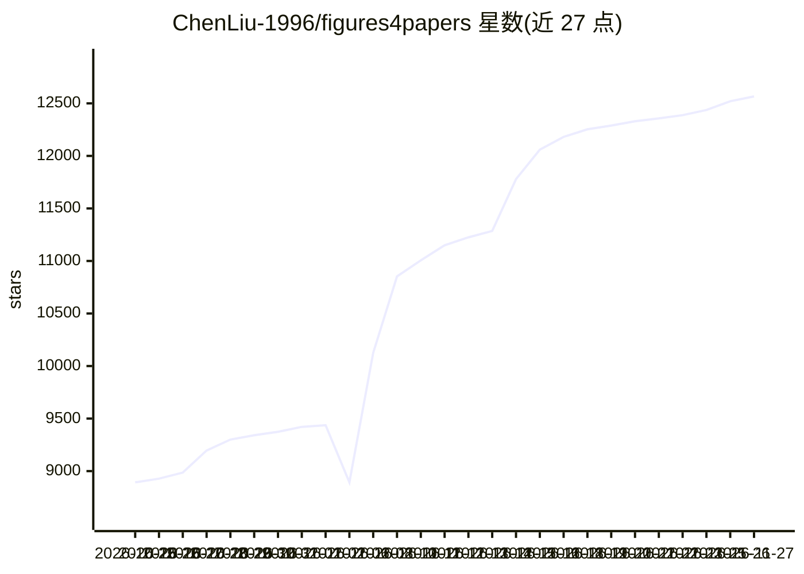

# ChenLiu-1996/figures4papers

⭐ 12,566 · Python · NOASSERTION · 推送 2026-11-22 · [GitHub](https://github.com/ChenLiu-1996/figures4papers) · [官网](https://chenliu-1996.github.io/) · 个人维护 · 中文 README

**面向 AI 会议与期刊投稿的 Python 论文绘图脚本集**

耶鲁大学博士生 Chen Liu 集中存放其个人论文绘图 Python 脚本的仓库，脚本产出的图用于 Nature Machine Intelligence、ICML、NeurIPS、ECCV 等发表物。仓库按图类型组织：定量对比柱状图、构成分解柱状图、3D 球体、雷达图、折线图、概念图、趋势图等，另收录部分非端到端 Python 完成的图。附 scientific-figure-making 技能目录（SKILL.md 与 references/），可在 Cursor、Claude Code、Codex 等 AI 编码代理中以路径引用或 symlink 方式安装，代理据此按仓库约定生成绘图脚本。

## 筛选速览

| 维度 | 判定 | 备注 |
|---|---|---|
| AI 角色 | `ai-knowledge` | 知识聚合/清单类 |
| 许可风险 | `none` | NOASSERTION |
| 部署形态 | `None` |  |
| 模型依赖 | — | README 未给出锁定关系 |
| 硬件要求 | — | 无带数字的原话,不猜 |
| 安装摩擦 | `low` | 无编译、无系统依赖或容器化 |
| 成熟度 | — | 结构信号不足 |

## 能力要点

- 按图类型组织的论文级 Python 绘图脚本集合（柱状/雷达/折线/概念/趋势等）
- scientific-figure-making 技能目录，含 SKILL.md 与设计理论参考文档
- 支持无安装的路径引用与 symlink 两种方式接入 AI 编码代理
- 提供可复制的 prompt 模板用于生成绘图脚本

## 适用场景

- 为投稿顶会/期刊的论文制作定量对比与概念示意图
- 在 AI 编码代理中按既有绘图规范生成新的 matplotlib 脚本
- 参考他人的科研绘图脚本写法与设计约定

## 场景标签

`科研工具` · 领域:学习与行业

## 证据(README 行号)

> L9: This is a centralized repository of my own **Python scripts for high-quality figures**.
> L35: ## LLM skill integration
> L53: You can use this skill **without installing anything**: open this repo in your AI coding agent (e.g. Cursor, Claude

## 星数曲线

2026-10-25 8,893 → 2026-11-27 12,566（+3,673）

---
*卡片 v1 · prompt 1.4 · 生成 2026-11-23 · 置信度 high · 依据 README sha `6f13bb07524a` · [字段定义](../../DATASET.md)*
