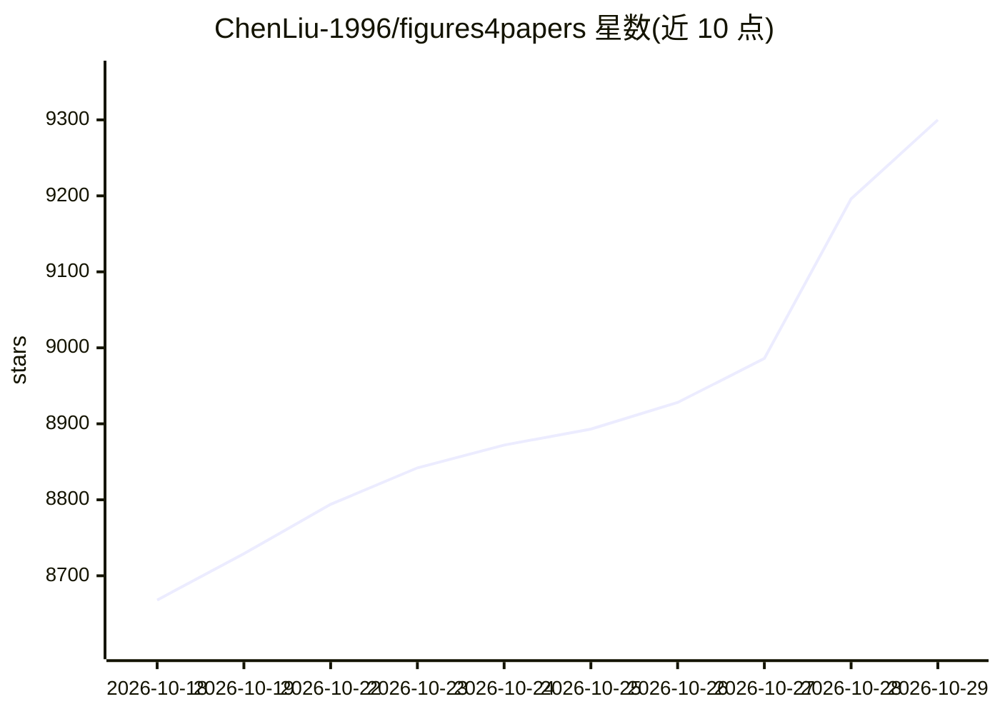

# ChenLiu-1996/figures4papers

⭐ 9,300 · Python · NOASSERTION · 推送 2026-10-19 · [GitHub](https://github.com/ChenLiu-1996/figures4papers) · [官网](https://chenliu-1996.github.io/) · 个人维护 · 中文 README

**科研论文出版级图表的 Python 脚本集与 AI agent 技能**

作者个人维护的 Python 绘图脚本集中仓库，产出发表于 Nature Machine Intelligence、ICML、NeurIPS、ECCV 等场合的出版级图表，涵盖柱状图、雷达图、趋势图、概念图等类型。附带 scientific-figure-making 技能（SKILL.md + 参考文档），可在 Cursor、Claude Code、Codex 等 AI 编码代理中以路径引用或 symlink 方式调用，由代理生成绘图脚本。仓库同时列出作者相关论文的引用信息。

## 筛选速览

| 维度 | 判定 | 备注 |
|---|---|---|
| AI 角色 | `ai-knowledge` | 知识聚合/清单类 |
| 许可风险 | `none` | NOASSERTION |
| 部署形态 | `None` |  |
| 模型依赖 | — | README 未给出锁定关系 |
| 硬件要求 | — | 无带数字的原话,不猜 |
| 安装摩擦 | `low` | 无编译、无系统依赖或容器化 |
| 成熟度 | — | 结构信号不足 |

## 能力要点

- 集中于出版级科研图表的 Python 脚本集合
- scientific-figure-making 技能含 SKILL.md 与设计理论参考文档
- 支持 Cursor / Claude Code / Codex 以路径或 symlink 方式接入技能
- 提供可直接复制的提示词模板驱动 AI 生成绘图脚本

## 适用场景

- 写论文时复用出版级图表的绘图脚本
- 让 AI 编码代理按技能约定生成符合规范的图表脚本
- 参考各类图表（柱状/雷达/趋势/概念图）的实现方式

## 场景标签

`提示工程` `科研工具` · 领域:Agent 开发

## 证据(README 行号)

> L9: This is a centralized repository of my own **Python scripts for high-quality figures**.
> L34: ## LLM skill integration
> L37: The **scientific figure making** skill lives in `scientific-figure-making/`. Demo figures live in `assets/`. Projec

## 星数曲线

2026-10-18 8,668 → 2026-10-29 9,300（+632）

---
*卡片 v1 · prompt 1.4 · 生成 2026-10-20 · 置信度 high · 依据 README sha `361f3ed22ff8` · [字段定义](../../DATASET.md)*
