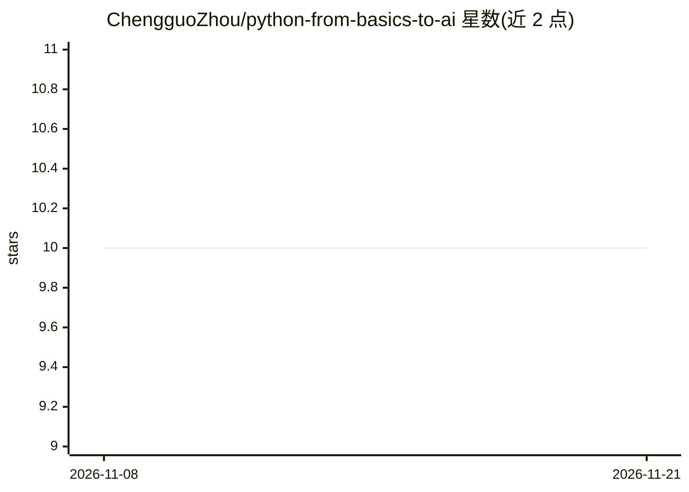

# ChengguoZhou/python-from-basics-to-ai

⭐ 10 · Jupyter Notebook · 推送 2026-04-11 · [GitHub](https://github.com/ChengguoZhou/python-from-basics-to-ai) · [官网](https://www.bilibili.com/video/BV1sHU9BmEne) · 个人维护 · 中文 README

**Python 初学者的入门学习练习合集，含 AI 应用方向**

个人 Python 学习过程记录仓库，按基础语法、文件操作与 JSON、网络爬虫、数据分析、AI 应用开发五个方向整理练习与小案例。AI 应用部分涉及大模型 API 调用、Streamlit 应用、聊天机器人、多轮会话记忆与历史会话保存。内容随学习进度持续补充，按目录逐步学习而非作为单一项目运行，运行需自备 Python 环境、第三方库与 API Key。

## 筛选速览

| 维度 | 判定 | 备注 |
|---|---|---|
| AI 角色 | `ai-knowledge` | 知识聚合/清单类 |
| 许可风险 | `none` | — |
| 部署形态 | `None` |  |
| 模型依赖 | — | README 未给出锁定关系 |
| 硬件要求 | — | 无带数字的原话,不猜 |
| 安装摩擦 | `low` | 无编译、无系统依赖或容器化 |
| 成熟度 | — | 结构信号不足 |

## 能力要点

- 覆盖基础语法、文件处理、爬虫、数据分析、AI 应用五个方向
- AI 应用方向含大模型 API 调用、Streamlit 开发、聊天机器人与会话记忆
- 按学习路径组织，含可运行和改写的小案例

## 适用场景

- 作为 Python 初学者的参考练习合集
- 参考从基础语法过渡到 AI 应用实战的学习路径
- 查看聊天机器人与 Streamlit 应用的入门实现思路

## 场景标签

`数据分析` `网页抓取` `聊天机器人` `教程课程` · 领域:效率与自动化

## 证据(README 行号)

> L3: 这是一个记录我学习 Python 过程的仓库。
> L9: 这个仓库更像一份持续更新的学习记录，内容会随着学习进度不断补充。
> L19: 其中，AI 应用方向可包含大模型 API 调用、Streamlit 开发、聊天机器人 / AI 伴侣、会话记忆，以及本地保存历史会话等内容。

## 星数曲线

2026-11-08 10 → 2026-11-21 10（+0）

---
*卡片 v1 · prompt 1.4 · 生成 2026-11-20 · 置信度 high · 依据 README sha `8699b7564c93` · [字段定义](../../DATASET.md)*
