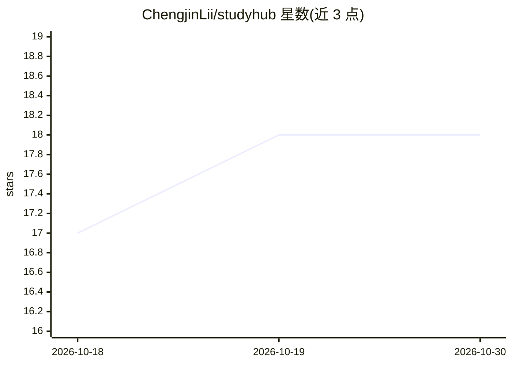

# ChengjinLii/studyhub

⭐ 18 · Python · MIT · 推送 2026-10-26 · [GitHub](https://github.com/ChengjinLii/studyhub) · [官网](https://study-hub.cn) · 组织维护 · 中文 README

**高校知识共享与校园互助平台，附带 RAG Agent 与 AI 内容审核**

面向高校学生的知识共享平台，功能覆盖课程资料共享、学习经验沉淀、求购协作与校园集市。AI 部分：StudyHub Agent 提供本地知识库、RAG（BM25+向量召回+RRF+Rerank）与多步工具 Agent；Review-Jev 用 Qwen3Guard-Gen-0.6B 与 ShieldGemma 2-4B 双路模型做文字与图片投稿审核，含人工复核分支。后端 FastAPI，前端 Next.js，支持 Docker Compose 部署与 PWA 安装，MIT 许可（Review-Jev 为 Apache-2.0）。

## 筛选速览

| 维度 | 判定 | 备注 |
|---|---|---|
| AI 角色 | `ai-enhanced` | 去掉 AI 部分产品仍成立 |
| 许可风险 | `permissive` | MIT |
| 部署形态 | `self-host` | docker 或自建部署 |
| 模型依赖 | — | README 未给出锁定关系 |
| 硬件要求 | — | 无带数字的原话,不猜 |
| 安装摩擦 | `low` | 无编译、无系统依赖或容器化 |
| 成熟度 | — | 结构信号不足 |

## 能力要点

- 资料共享/经验分享/求购协作/校园集市四类场景
- Agent：PDF/OCR 解析、Parent-Child 分层索引、RAG 与多步工具调用、引用核查
- Review-Jev：双模型内容审核，含置信度门槛与人工复核
- Docker Compose 部署与 PWA 移动端安装

## 适用场景

- 上传和获取课程资料、复习提纲与学习笔记
- 发布求购需求或校内二手交易信息
- 通过内置 Agent 基于本地文档进行问答
- 对文字与图片投稿进行内容审核

## 场景标签

`知识库管理` `RAG` · 领域:知识与检索

## 证据(README 行号)

> L20: StudyHub 连接学习资料、经验分享与校园互助，围绕高校学生的学习和生活需求，提供资源共享、求购协作与校园集市服务。
> L38: |资料共享|上传、浏览与获取课程资料、复习提纲和学习笔记|
> L155: **独立运行的文档知识库、RAG 与 Agent。**

## 星数曲线

2026-10-18 17 → 2026-10-30 18（+1）

---
*卡片 v1 · prompt 1.4 · 生成 2026-10-29 · 置信度 high · 依据 README sha `92b41974bf53` · [字段定义](../../DATASET.md)*
