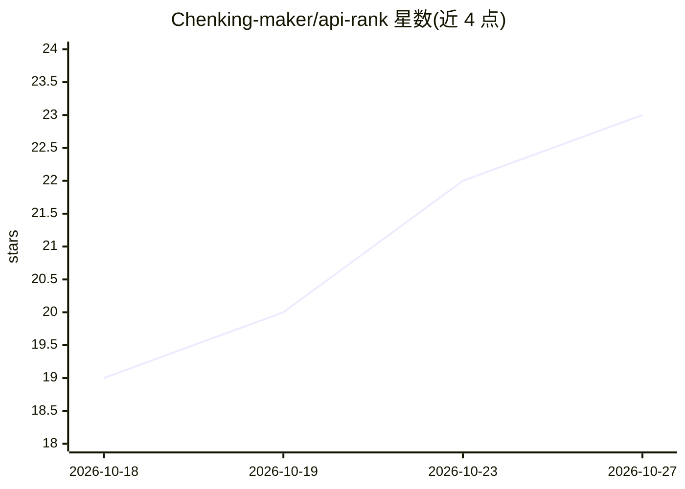

# Chenking-maker/api-rank

⭐ 23 · HTML · 推送 2026-10-26 · [GitHub](https://github.com/Chenking-maker/api-rank) · [官网](https://api-rank-lake.vercel.app) · 个人维护 · 中文 README

**AI API 中转站评测排行网站：166+ 平台多维度评分与选站推荐**

面向 AI 开发者的 API 中转站聚合排行静态网站：收录 166+ 个聚合 Claude/GPT/Gemini/DeepSeek 等模型的代理平台，按延迟、价格、稳定性、模型真实性等 7 个维度打分排名。提供快速选站器（按需求推荐 5 个站点）、随机盲选、邀请链接汇总与失效站点标记，附 34 篇相关文章。前端为 Vanilla JS 静态页面，数据存于 JSON，可部署到 GitHub Pages/Vercel/Cloudflare Pages，分享系统后端用 Cloudflare Workers + D1。更新为手动方式（已取消自动检测）。

## 筛选速览

| 维度 | 判定 | 备注 |
|---|---|---|
| AI 角色 | `ai-knowledge` | 知识聚合/清单类 |
| 许可风险 | `none` | — |
| 部署形态 | `library` | 以包/库形式分发 |
| 模型依赖 | — | README 未给出锁定关系 |
| 硬件要求 | — | 无带数字的原话,不猜 |
| 安装摩擦 | `low` | 无编译、无系统依赖或容器化 |
| 成熟度 | — | 结构信号不足 |

## 能力要点

- 7 维度评分体系（延迟/价格/稳定性/模型真实性/响应速度/免费额度/口碑）
- 收录 166+ 中转站，121 个有效、26 个失效（动态交叉验证）
- 快速选站器按需求推荐 5 个站点，随机盲选功能
- 纯静态前端（HTML/CSS/Vanilla JS），三平台部署，MIT 开源

## 适用场景

- 对比挑选 Claude/GPT/Gemini/DeepSeek 的 API 中转站
- 按模型类型、预算、用途筛选代理平台
- 查看中转站价格与官方价格的对比信息

## 场景标签

`精选清单` · 领域:学习与行业

## 证据(README 行号)

> L14:  🏆 AI API中转站排行榜
> L81: 本站采用7大维度综合评分，确保排名客观公正：
> L152: |收录平台|166+|

## 星数曲线

2026-10-18 19 → 2026-10-27 23（+4）

---
*卡片 v1 · prompt 1.4 · 生成 2026-10-27 · 置信度 mid · 依据 README sha `983178677a51` · [字段定义](../../DATASET.md)*
