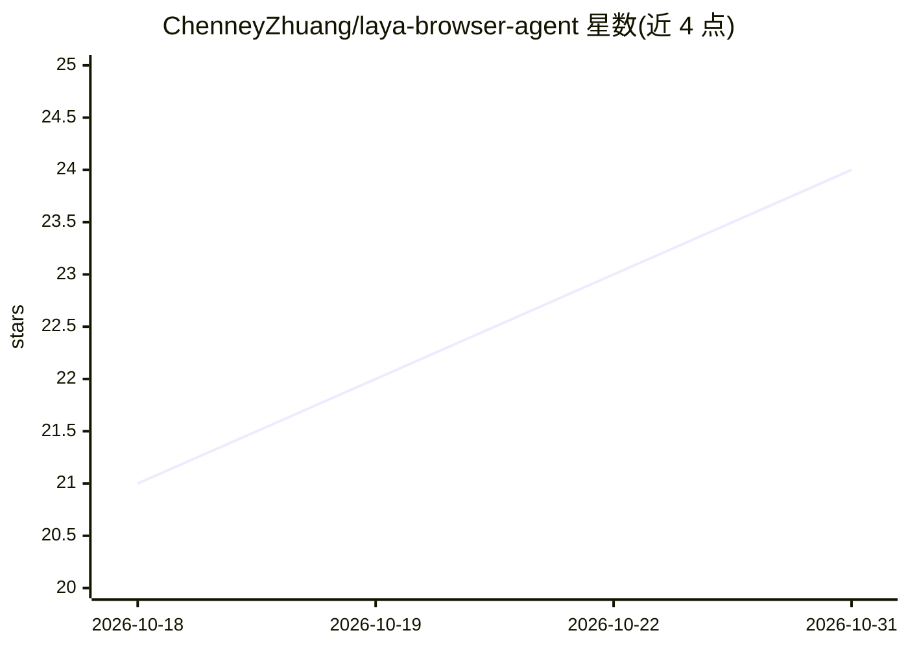

# ChenneyZhuang/laya-browser-agent

⭐ 24 · Python · Apache-2.0 · 推送 2026-10-01 · [GitHub](https://github.com/ChenneyZhuang/laya-browser-agent) · [官网](https://github.com/ChenneyZhuang/laya-browser-agent#readme) · 个人维护 · 中文 README

**本地运行 Laya 决策模型驱动浏览器 agent 的中立接入框架**

面向浏览器自动化 agent 的本地决策模型运行环境：在自有机器上通过 MLX 或 PyTorch 运行 Laya 开源权重（System One 架构，返回类型化决策而非文本），也接受自定义 answer(state, questions) 后端或任意兼容 System One 形状的 HTTP 端点。内置浏览器循环、Playwright/CDP 驱动、动作空间校验与置信度门控，输出校验失败则回退（fails open）。兼容 TypeSafe /v1/systemone 方言，现有 Jev 工具改一个 base URL 即可指向本地。模型输出永不成为选择器、坐标或可执行代码。

## 筛选速览

| 维度 | 判定 | 备注 |
|---|---|---|
| AI 角色 | `ai-ecosystem` | LLM/agent 周边工具 |
| 许可风险 | `permissive` | Apache-2.0 |
| 部署形态 | `library` | 以包/库形式分发 |
| 模型依赖 | — | README 未给出锁定关系 |
| 硬件要求 | `cpu-ok` | |
| 安装摩擦 | `medium` | 含编译或系统依赖之一 |
| 成熟度 | — | 结构信号不足 |

## 能力要点

- MLX/PyTorch 本地运行 Laya 开源权重，也支持自定义后端与 HTTP 端点
- 实现 TypeSafe /v1/systemone 方言，Jev 工具改 base URL 即可切换
- 输出校验（选项集、概率和、argmax）失败即 fails open 回退
- 内置浏览器循环、Playwright/CDP 驱动、动作空间约束与 loop guards

## 适用场景

- 把浏览器 agent 的决策环节换成本地运行的模型，不依赖云端与 API key
- 让现有 Jev 工具链无缝指向本地决策端点
- 约束模型只能从给定控件表中选择操作与元素，降低误操作风险

## 场景标签

`浏览器自动化` · 领域:效率与自动化

## 证据(README 行号)

> L129: What was missing was the boring part: a **neutral, local, agent-agnostic harness**.
> L30: This project wires those models into that role, locally, for whatever agent you
> L118: loop guards, and a TypeSafe-compatible server around an explicitly configured

## 星数曲线

2026-10-18 21 → 2026-10-31 24（+3）

---
*卡片 v1 · prompt 1.4 · 生成 2026-10-27 · 置信度 mid · 依据 README sha `8d31b800a1cd` · [字段定义](../../DATASET.md)*
