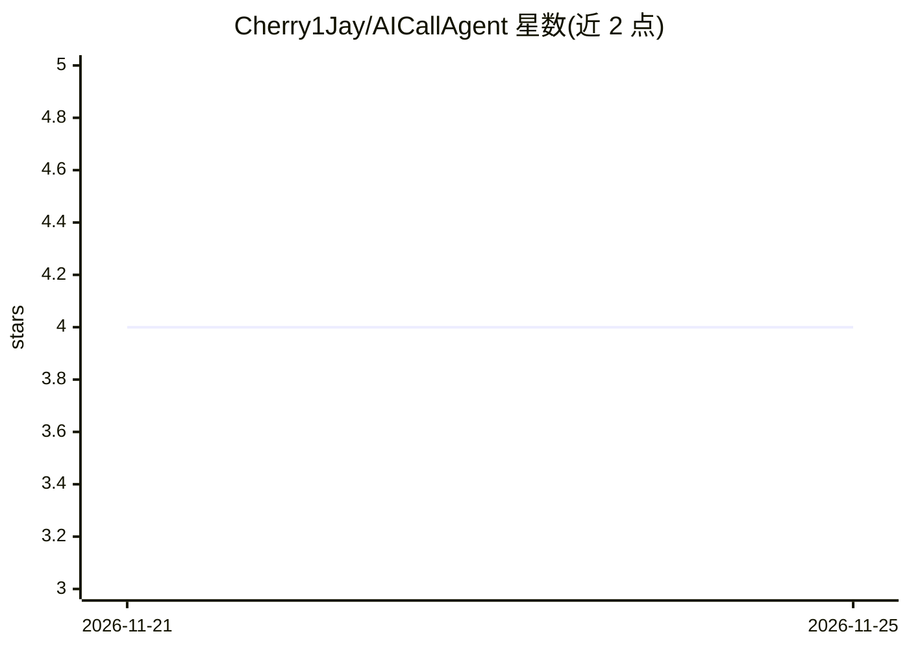

# Cherry1Jay/AICallAgent

⭐ 4 · Java · MIT · 推送 2026-11-13 · [GitHub](https://github.com/Cherry1Jay/AICallAgent) · 个人维护 · 中文 README

**用任意 OpenAI 兼容大模型接管小米 AI 通话回复的 LSPosed 模块**

面向小米 HyperOS 用户的 Xposed/LSPosed 模块：hook 小爱同学进程内 AI 通话引擎的单轮对话入口，把「生成回复」替换为用户自配的 OpenAI 兼容模型，接听、字幕、TTS 等仍走系统原生。支持按 6 类来电类型（外卖/快递/推销/客服/联系人/陌生号）分流，每类独立开关与自定义提示词，带 9 秒整轮超时兜底、输出净化截断与逐轮通话记录。仅在小米 17 Pro/HyperOS 4.0 实测，强依赖未混淆类名，小爱升级可能导致失效。

## 筛选速览

| 维度 | 判定 | 备注 |
|---|---|---|
| AI 角色 | `ai-native` | 本体是模型或模型工具 |
| 许可风险 | `permissive` | MIT |
| 部署形态 | `None` |  |
| 模型依赖 | local-ok | 支持本地模型 |
| 硬件要求 | — | 无带数字的原话,不猜 |
| 安装摩擦 | `medium` | 含编译或系统依赖之一 |
| 成熟度 | — | 结构信号不足 |

## 能力要点

- hook 小爱进程内 CallConversationEngine，只替换回复生成环节
- 6 类来电类型分流，每类独立开关与自定义提示词
- 任意 OpenAI 兼容 /chat/completions 端点，默认 DeepSeek
- 9 秒超时兜底、80 字 TTS 截断、思考内容过滤

## 适用场景

- 把小米 AI 通话的回复换成自己选的模型和提示词
- 推销电话交回原生话术、外卖快递交给自己的模型接
- 调提示词时查看逐轮通话记录排查效果

## 场景标签

`语音 Agent` · 领域:对话与助手

## 证据(README 行号)

> L7: 一个 LSPosed 模块：接管 HyperOS 的 AI 自动接听，用任意 OpenAI 兼容接口（DeepSeek / Kimi / Qwen / GLM / Ollama / one-api 中转…）生成对话，并按来电话类型分
> L30: |**`com.miui.voiceassist`（小爱）**|**ASR → LLM → TTS 全在这里**，`classes29.dex`|

## 星数曲线

2026-11-21 4 → 2026-11-25 4（+0）

---
*卡片 v1 · prompt 1.4 · 生成 2026-11-21 · 置信度 high · 依据 README sha `85ad3dbcaebc` · [字段定义](../../DATASET.md)*
