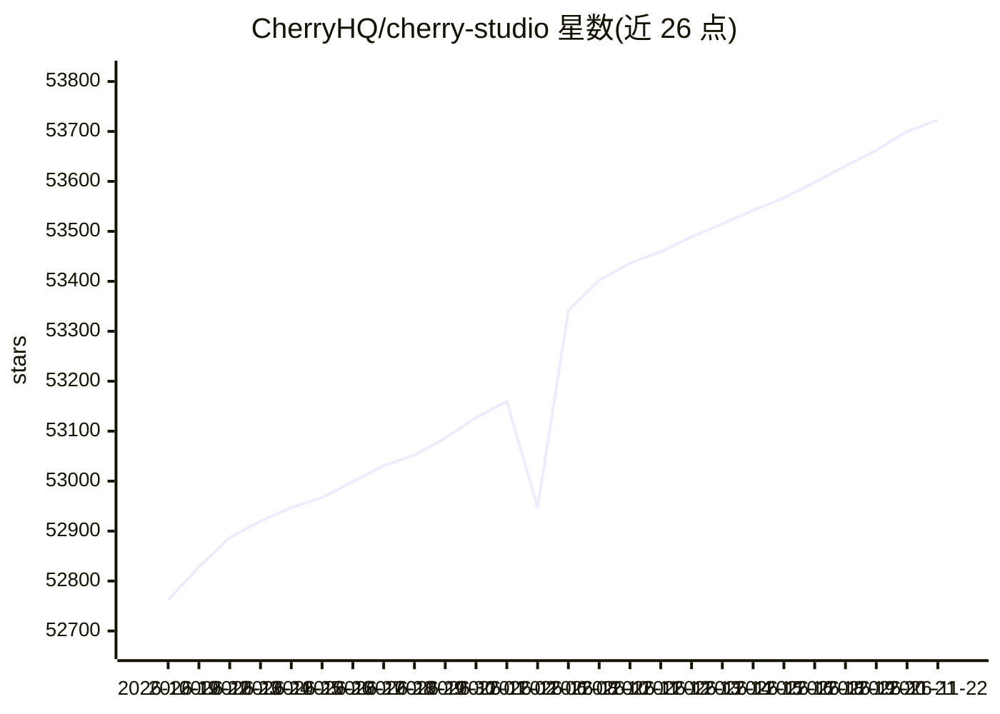

# CherryHQ/cherry-studio

⭐ 53,723 · TypeScript · AGPL-3.0 · 推送 2026-11-21 · [GitHub](https://github.com/CherryHQ/cherry-studio) · [官网](https://cherryai.com) · 组织维护 · 中文 README

**面向个人与团队的桌面 AI 工作台：聚合模型、Agent 与知识库**

跨 Windows/macOS/Linux 的 AI 桌面客户端：在统一界面内连接云端与本地模型进行多模型对话、构建本地知识库（支持 PDF/Office/OCR 文档处理）、生成与编辑图像、翻译与联网搜索，并创建带指令、工具权限与工作区的 Agent，可运行定时任务、接入消息平台，通过 Skills 与 MCP 服务器扩展能力。提供本地存储与 WebDAV 备份；部分功能需 API 凭据或下载模型。另有 iOS/Android 移动端及面向企业的企业版。

## 筛选速览

| 维度 | 判定 | 备注 |
|---|---|---|
| AI 角色 | `ai-native` | 本体是模型或模型工具 |
| 许可风险 | `dual` | AGPL-3.0 |
| 部署形态 | `None` |  |
| 模型依赖 | local-ok | 支持本地模型 |
| 硬件要求 | — | 无带数字的原话,不猜 |
| 安装摩擦 | `low` | 无编译、无系统依赖或容器化 |
| 成熟度 | — | 结构信号不足 |

## 动量与使用信号

- 维护:`active` — 距上次 push 0.6 天,年发版 73,411 位贡献者
- 涨星:近 1 天 **+37**(自 20261016 起算)
- 下载:GitHub Release 附件 累计 28,077,246(100 个 release)
- 平台:WINDOWS / LINUX / ANDROID / IOS · 协议:MCP / OLLAMA

## 能力要点

- 多模型对话与助手对比，支持 OpenAI/Anthropic/Gemini 等云服务
- 通过 Ollama 与 LM Studio 使用本地模型
- 本地知识库构建，支持 PDF/Office/OCR 文档处理
- Agent 支持文件操作、命令执行、浏览器与计算机自动化，可经 MCP 扩展

## 适用场景

- 在一个客户端里同时使用多家云模型和本地模型
- 把本地文档建成知识库供对话和 Agent 检索
- 创建自动化 Agent 处理文件、网页与多步任务
- 配置 API Gateway 让其他应用接入已配置的模型

## 场景标签

`AI 助手` `RAG` `GUI 自动化` · 领域:效率与自动化

## 证据(README 行号)

> L25: Cherry Studio is an AI workstation for Windows, macOS, and Linux. Chat with multiple models, work with agents, buil
> L68: - ☁️ Connect OpenAI, Anthropic, Gemini, and other cloud providers, or add custom compatible services.
> L127: Cherry Studio Enterprise Edition brings centralized model management, shared knowledge bases, employee access cont

## 星数曲线

2026-10-19 52,762 → 2026-11-22 53,723（+961）

---
*卡片 v1 · prompt 1.4 · 生成 2026-11-22 · 置信度 high · 依据 README sha `09c890a1917d` · [字段定义](../../DATASET.md)*
