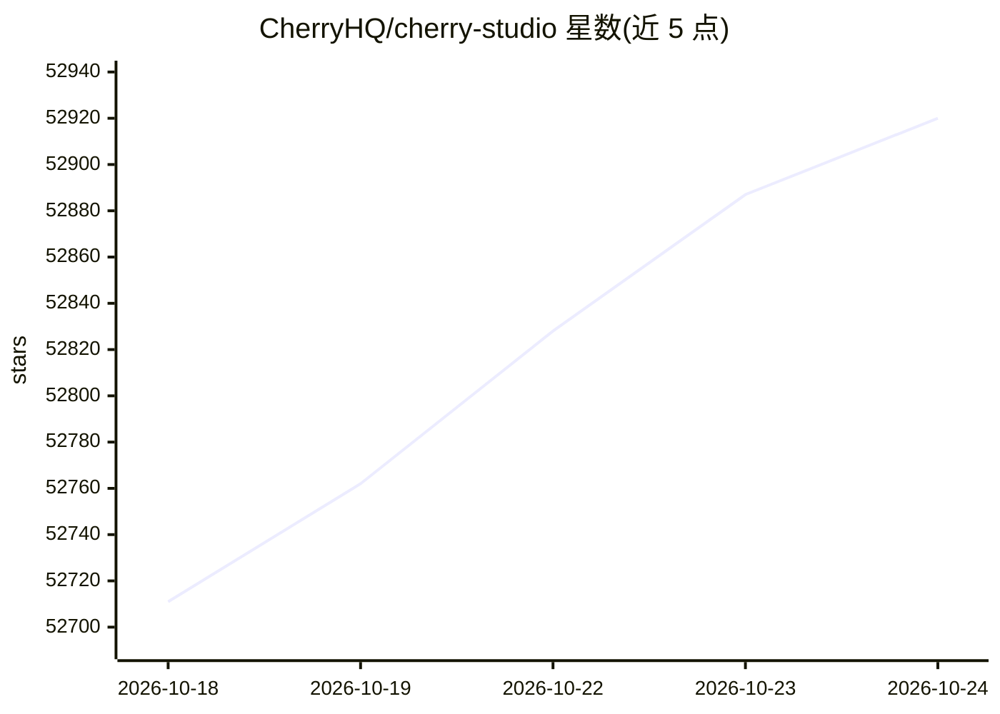

# CherryHQ/cherry-studio

⭐ 52,920 · TypeScript · AGPL-3.0 · 推送 2026-10-23 · [GitHub](https://github.com/CherryHQ/cherry-studio) · [官网](https://cherryai.com) · 组织维护 · 中文 README

**多模型桌面 AI 客户端：统一接入云/本地 LLM 与助手**

支持多 LLM 提供商的桌面客户端，覆盖 Windows、Mac 和 Linux。核心功能包括：接入主流云服务（OpenAI、Gemini、Anthropic 等）与本地模型（Ollama、LM Studio）；300+ 预配置助手与自定义助手、多模型同时对话；支持文本/图片/Office/PDF 文档处理、WebDAV 备份、Mermaid 图表；集成搜索、翻译、MCP 服务器等工具。安装后即用，无需环境配置。另有企业版提供私有部署、统一模型管理与知识库（非完全开源）。社区版采用 AGPL-3.0 许可，商业豁免需联系官方。

## 筛选速览

| 维度 | 判定 | 备注 |
|---|---|---|
| AI 角色 | `ai-ecosystem` | LLM/agent 周边工具 |
| 许可风险 | `dual` | AGPL-3.0 |
| 部署形态 | `None` |  |
| 模型依赖 | local-ok | 支持本地模型 |
| 硬件要求 | — | 无带数字的原话,不猜 |
| 安装摩擦 | `low` | 无编译、无系统依赖或容器化 |
| 成熟度 | — | 结构信号不足 |

## 动量与使用信号

- 维护:`active` — 距上次 push 0.6 天,年发版 73,411 位贡献者
- 涨星:近 1 天 **+37**(自 20261016 起算)
- 下载:GitHub Release 附件 累计 28,077,246(100 个 release)
- 平台:WINDOWS / LINUX / ANDROID / IOS · 协议:MCP / OLLAMA

## 能力要点

- 支持 OpenAI、Gemini、Anthropic 等云服务与 Ollama、LM Studio 本地模型
- 300+ 预配置 AI 助手，支持多模型同时对话
- 支持 MCP（Model Context Protocol）服务器与小程序
- 跨平台桌面应用，开箱即用无需环境配置

## 适用场景

- 在一个桌面客户端中统一使用多家云 LLM 与本地模型
- 调用预配置助手处理文档、翻译和代码任务
- 企业私有部署集中管理团队模型访问与知识库

## 场景标签

`AI 助手` `文档问答` · 领域:对话与助手

## 证据(README 行号)

> L25: Cherry Studio is a desktop client that supports multiple LLM providers, available on Windows, Mac and Linux.
> L39: - ☁️ Major LLM Cloud Services: OpenAI, Gemini, Anthropic, and more
> L41: - 💻 Local Model Support with Ollama, LM Studio

## 星数曲线

2026-10-18 52,711 → 2026-10-24 52,920（+209）

---
*卡片 v1 · prompt 1.4 · 生成 2026-10-18 · 置信度 high · 依据 README sha `04f78afe5974` · [字段定义](../../DATASET.md)*
