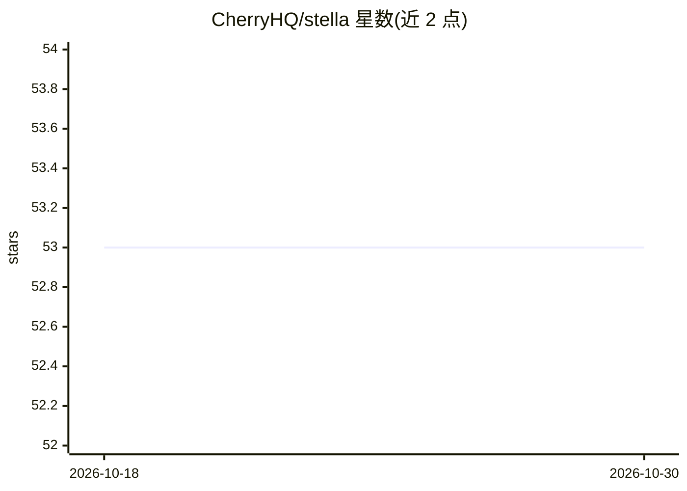

# CherryHQ/stella

⭐ 53 · Go · AGPL-3.0 · 推送 2026-10-21 · [GitHub](https://github.com/CherryHQ/stella) · [官网](https://stella.cherryai.com) · 组织维护 · 中文 README

**面向团队的共享 AI 同事系统：多用户多 agent、记忆与工具沙箱**

用 Go 实现的单租户多用户多 agent 部署系统：领域负责人为 agent 配置指令、技能、工具、知识与记忆规则，团队成员通过 Telegram、Discord、QQ、飞书、钉钉、微信、Web UI 或终端与同一批 agent 对话。每人有独立的按用户按 agent 记忆；agent 在沙箱化工作区运行、受工具访问边界约束。支持 MCP 远程工具（streamable HTTP/SSE）、技能包四级作用域（user_agent>user>system_agent>system）、定时任务与 Webhooks。README 声明处于重度开发阶段、不稳定、不建议生产使用。AGPLv3+ 许可。

## 筛选速览

| 维度 | 判定 | 备注 |
|---|---|---|
| AI 角色 | `ai-native` | 本体是模型或模型工具 |
| 许可风险 | `viral` | AGPL-3.0 |
| 部署形态 | `library` | 以包/库形式分发 |
| 模型依赖 | — | README 未给出锁定关系 |
| 硬件要求 | — | 无带数字的原话,不猜 |
| 安装摩擦 | `low` | 无编译、无系统依赖或容器化 |
| 成熟度 | `idea` | |

## 能力要点

- 多用户多 agent：一次部署为一个信任边界，各 agent 有独立角色、模型、工具与安全边界
- 7 个聊天渠道（Telegram/Discord/QQ/飞书/钉钉/微信/Web UI/终端）共享同一记忆
- 远程 MCP 工具接入与四级作用域的技能包机制
- 沙箱工作区、定时任务与跨重启持久化的后台任务

## 适用场景

- 团队把财务、HR、工程等领域知识配置成共享 AI 同事，成员在常用聊天工具里直接提问
- 为不同成员保留与 agent 的独立记忆和上下文
- 部署自管的 agent 服务并使用自己的模型 API key

## 场景标签

`AI 助手` `多智能体` `Agent 记忆` · 领域:Agent 开发

## 证据(README 行号)

> L9: Stella turns the expertise your team repeats — finance, HR, engineering, research — into shared AI coworkers. Set an
> L13: Under the hood it's a single-tenant, multi-user, multi-agent system: one deployment is one trust boundary, many peo
> L23: - **Lives in the chat you already use.** Telegram, Discord, QQ, Feishu, DingTalk, WeChat, the Web UI, and the termi

## 星数曲线

2026-10-18 53 → 2026-10-30 53（+0）

---
*卡片 v1 · prompt 1.4 · 生成 2026-10-24 · 置信度 high · 依据 README sha `6d61b00d3882` · [字段定义](../../DATASET.md)*
