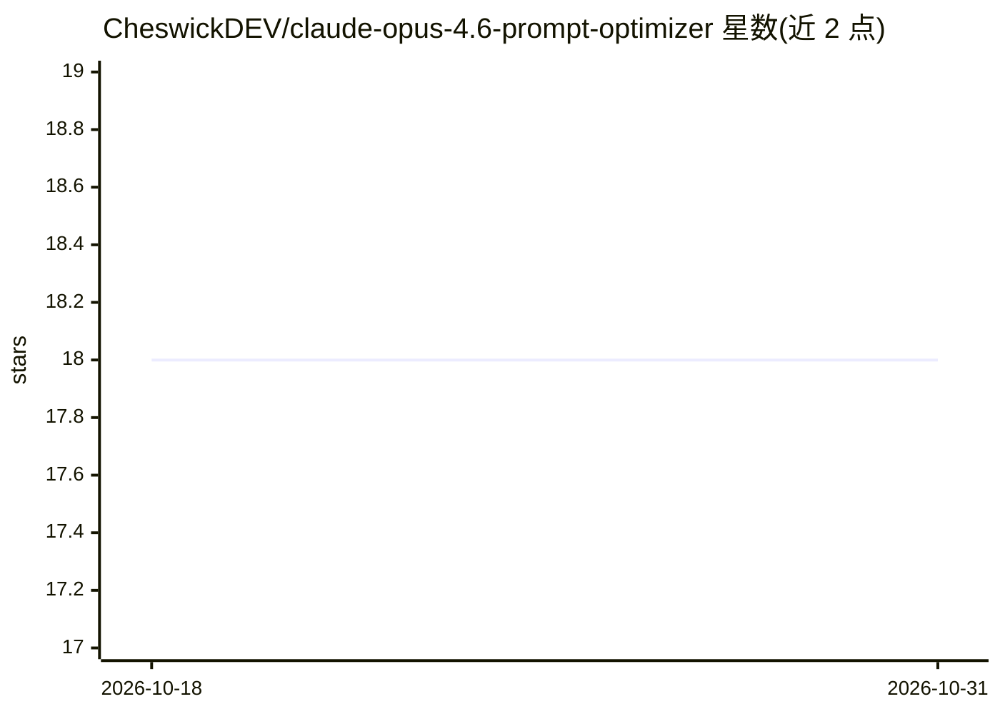

# CheswickDEV/claude-opus-4.6-prompt-optimizer

⭐ 18 · MIT · 推送 2026-05-28 · [GitHub](https://github.com/CheswickDEV/claude-opus-4.6-prompt-optimizer) · 个人维护

**把原始提示词改写为 Claude Opus 4.6 专用结构化提示词的元提示系统**

以 CLAUDE.md 元提示文件形式提供的提示词优化系统：用户粘贴任意原始提示词，系统按 5 步流程（意图分析、复杂度路由、规则应用、质量检查、结构化输出）生成带 XML 标签的优化提示词。核心机制包括 10 条优化规则、10 组件提示词框架、按复杂度分配组件数（3-4/5-7/10），并针对 Opus 4.6 的 200K 上下文、自适应思考、不支持的 prefill 等行为做适配。使用方式为粘贴到 Claude Project 系统指令或经 Anthropic API 调用，无独立安装程序。注意：README 顶部声明本版本已被 Opus 4.8 版取代，仅作参考保留。

## 筛选速览

| 维度 | 判定 | 备注 |
|---|---|---|
| AI 角色 | `ai-knowledge` | 知识聚合/清单类 |
| 许可风险 | `permissive` | MIT |
| 部署形态 | `None` |  |
| 模型依赖 | locked-api |  |
| 硬件要求 | — | 无带数字的原话,不猜 |
| 安装摩擦 | `low` | 无编译、无系统依赖或容器化 |
| 成熟度 | — | 结构信号不足 |

## 能力要点

- 10 条优化规则 + 10 组件提示词框架，按复杂度路由选择子集
- 输出 XML 标签结构化提示词，附变更说明
- 针对 Opus 4.6 特性适配（200K 上下文、自适应思考、无 prefill）
- 支持 Claude Project / 直接粘贴 / API 三种使用方式

## 适用场景

- 把模糊的一句话需求改写成可投入生产的结构化提示词
- 让编码、写作、分析类任务获得领域专家角色与明确约束
- 学习 Anthropic 官方提示词最佳实践的落地实现

## 场景标签

`提示工程` · 领域:Agent 开发

## 证据(README 行号)

> L14: **Claude Prompt Optimizer** is a meta-prompting system that transforms vague, unstructured prompts into professiona
> L198: ├── CLAUDE.md                          # Core meta-prompt (the optimizer engine)
> L3: > This 4.6 optimizer has been superseded. The 4.8 edition is calibrated for Opus 4.8 (effort defaults to `high` ever

## 星数曲线

2026-10-18 18 → 2026-10-31 18（+0）

---
*卡片 v1 · prompt 1.4 · 生成 2026-10-29 · 置信度 high · 依据 README sha `37d5ad6b16e0` · [字段定义](../../DATASET.md)*
