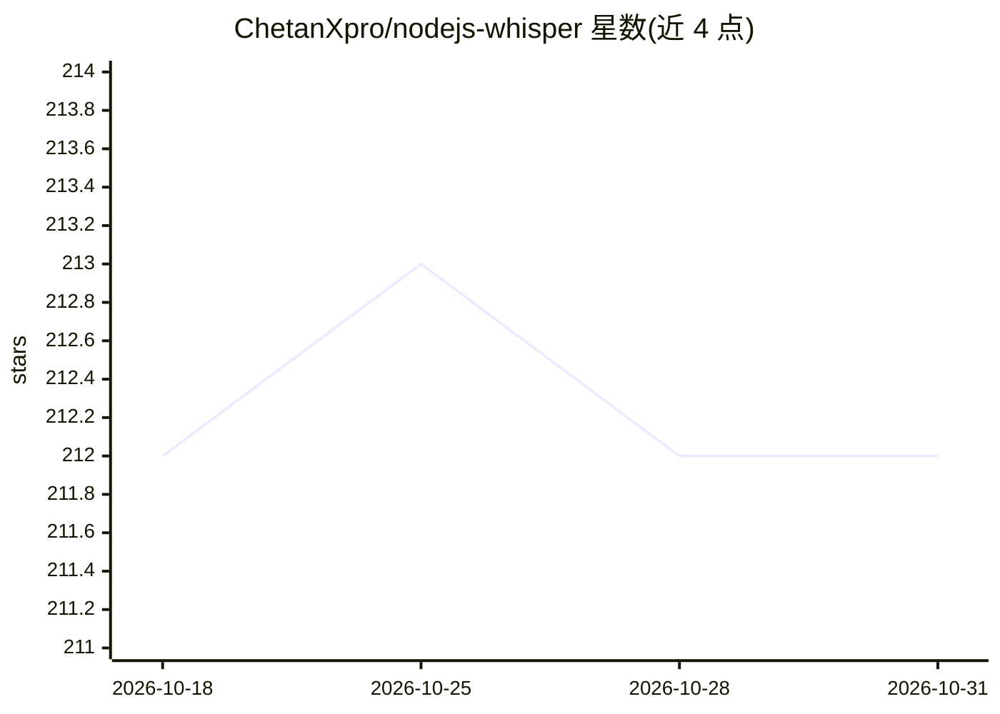

# ChetanXpro/nodejs-whisper

⭐ 212 · TypeScript · MIT · 推送 2026-10-27 · [GitHub](https://github.com/ChetanXpro/nodejs-whisper) · [官网](https://npmjs.com/nodejs-whisper) · 个人维护

**Whisper 语音转文字的 Node.js 绑定库，CPU 运行**

对 OpenAI Whisper 模型（基于 whisper.cpp 实现）的 Node.js 绑定：在 CPU 上运行（含 Apple Silicon ARM），自动将音频转换为 16000Hz WAV，输出 txt/srt/vtt/json/wts/lrc 等格式字幕与转写文本，支持词级时间戳、按词切分与翻译为英语（可选），并提供 Silero VAD 静音检测以减少长录音处理量。安装时需系统具备 make 工具（Linux 用 build-essential，Windows 用 MinGW-w64/MSYS2），通过 npm 安装并用 npx 命令下载模型。面向需要在 Node.js 项目中集成语音转文字的开发者。

## 筛选速览

| 维度 | 判定 | 备注 |
|---|---|---|
| AI 角色 | `ai-native` | 本体是模型或模型工具 |
| 许可风险 | `permissive` | MIT |
| 部署形态 | `library` | 以包/库形式分发 |
| 模型依赖 | — | README 未给出锁定关系 |
| 硬件要求 | — | 无带数字的原话,不猜 |
| 安装摩擦 | `medium` | 含编译或系统依赖之一 |
| 成熟度 | — | 结构信号不足 |

## 能力要点

- CPU 优化的 Whisper 转写（含 Apple Silicon ARM）
- 输出 txt/srt/vtt/json/wts/lrc 多种字幕与文本格式
- 词级时间戳与按词切分（可选）、翻译为英语（可选）
- Silero VAD 语音活动检测，自动跳过静音段

## 适用场景

- 在 Node.js 应用中为音频/视频生成字幕文件
- 本地 CPU 环境批量转写录音为文本
- 需要词级时间戳的转录场景

## 场景标签

`语音识别` · 领域:感知与多模态

## 证据(README 行号)

> L3: Node.js bindings for OpenAI's Whisper model.
> L9: - Automatically convert the audio to WAV format with a 16000 Hz frequency to support the whisper model.

## 星数曲线

2026-10-18 212 → 2026-10-31 212（+0）

---
*卡片 v1 · prompt 1.4 · 生成 2026-10-22 · 置信度 high · 依据 README sha `8ef748585e9d` · [字段定义](../../DATASET.md)*
