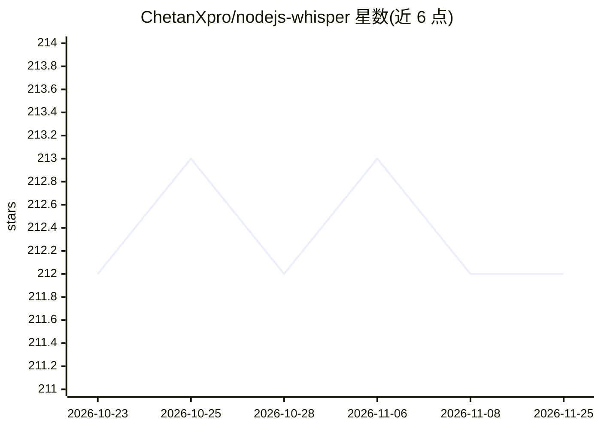

# ChetanXpro/nodejs-whisper

⭐ 212 · TypeScript · MIT · 推送 2026-11-16 · [GitHub](https://github.com/ChetanXpro/nodejs-whisper) · [官网](https://npmjs.com/nodejs-whisper) · 个人维护

**Node.js 开发者的 Whisper 语音转录绑定库**

whisper.cpp 的 Node.js 绑定，将音频自动转为 16 kHz WAV 后运行 OpenAI Whisper 模型做语音转录，输出 txt/srt/vtt/json/wts/lrc 格式，支持词级时间戳、源语言到英语的翻译、VAD 语音活动检测。提供 native 与 CLI 两种后端自动回退，带并发队列控制、请求取消、模型常驻与空闲释放机制。面向 Node.js 开发者，通过 npm 安装，无匹配预编译二进制时需 CMake 与 C++17 编译器本地构建。

## 筛选速览

| 维度 | 判定 | 备注 |
|---|---|---|
| AI 角色 | `ai-native` | 本体是模型或模型工具 |
| 许可风险 | `permissive` | MIT |
| 部署形态 | `library` | 以包/库形式分发 |
| 模型依赖 | — | README 未给出锁定关系 |
| 硬件要求 | — | 无带数字的原话,不猜 |
| 安装摩擦 | `high` | 编译与系统依赖俱全 |
| 成熟度 | — | 结构信号不足 |

## 能力要点

- 自动转换音频为 16 kHz WAV，输出 6 种转录格式
- 词级时间戳与可选按词切分、翻译到英语
- native/CLI 双后端 auto 回退与并发队列（默认 1 并发/100 排队）
- VAD 检测（Silero 模型 <1MB 可自动下载）减少静音段计算

## 适用场景

- 在 Node.js 服务中批量转录音频为带时间戳字幕
- 为长录音启用 VAD 跳过静音段降低计算量
- Docker 容器中挂载目录缓存转录模型

## 场景标签

`语音识别` · 领域:感知与多模态

## 证据(README 行号)

> L3: Node.js bindings for OpenAI's Whisper model.
> L10: - Output transcripts to (.txt .srt .vtt .json .wts .lrc)
> L82: By default, one transcription runs at a time and up to 100 requests can wait. Each waiting request starts when

## 星数曲线

2026-10-23 212 → 2026-11-25 212（+0）

---
*卡片 v1 · prompt 1.4 · 生成 2026-11-25 · 置信度 high · 依据 README sha `eca466171838` · [字段定义](../../DATASET.md)*
