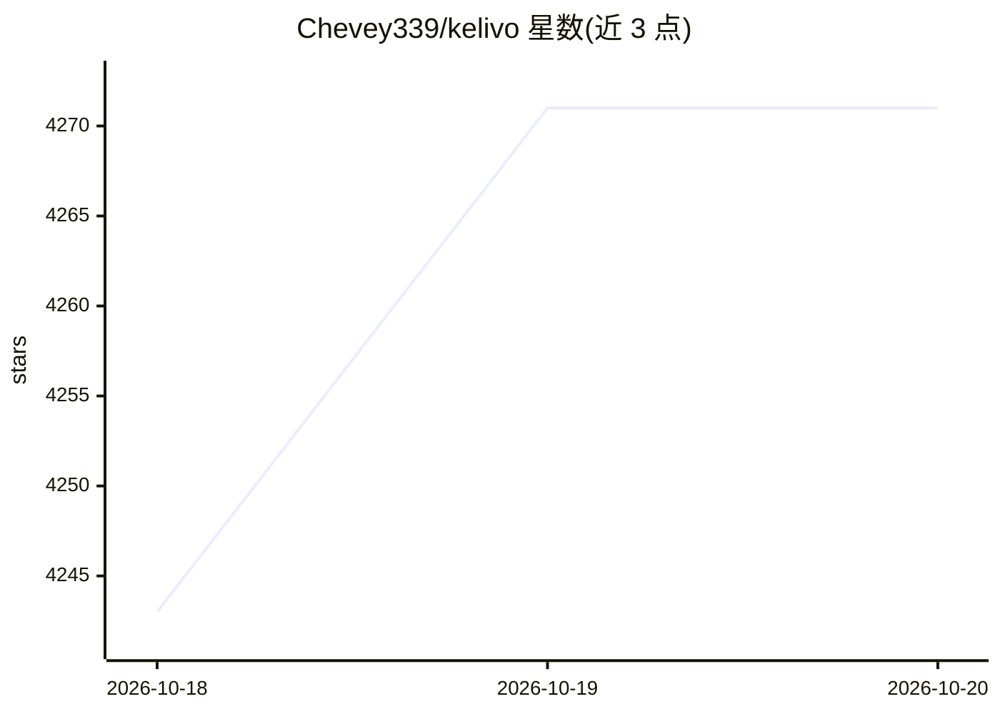

# Chevey339/kelivo

⭐ 4,271 · Dart · AGPL-3.0 · 推送 2026-10-19 · [GitHub](https://github.com/Chevey339/kelivo) · [官网](https://kelivo.psycheas.top) · 个人维护 · 中文 README

**跨平台 LLM 聊天客户端，聚合多家模型并支持本地工作区**

用 Flutter 构建的开源 LLM 客户端，覆盖 Android、iOS、macOS、Windows 与 Linux。用户接入自己的 API key（OpenAI、Gemini、Claude、DeepSeek、OpenRouter 及任意 OpenAI 兼容端点）或用 ChatGPT/Grok/Kimi 账号登录。除聊天外支持工作区（shell/文件读写等七种工具，手机端经 PRoot/iSH Linux 沙箱运行）、MCP、技能导入、长期记忆、24 种网页搜索服务、语音与视觉输入。数据本地存储，无自带账号系统，可备份至 WebDAV/S3。

## 筛选速览

| 维度 | 判定 | 备注 |
|---|---|---|
| AI 角色 | `ai-native` | 本体是模型或模型工具 |
| 许可风险 | `viral` | AGPL-3.0 |
| 部署形态 | `desktop` | 安装包/桌面程序 |
| 模型依赖 | locked-api |  |
| 硬件要求 | — | 无带数字的原话,不猜 |
| 安装摩擦 | `medium` | 含编译或系统依赖之一 |
| 成熟度 | — | 结构信号不足 |

## 能力要点

- 工作区给模型提供 shell、read_file、write_file 等七种工具，手机端在 Linux 沙箱内运行
- 原生支持 OpenAI/Gemini/Claude 协议及任意 OpenAI 兼容端点，多 key 负载均衡
- MCP 连接（Streamable HTTP/SSE/STDIO）、技能导入（SKILL.md）与长期记忆管道
- 本地存储、无账号系统，支持 WebDAV/S3 备份与 Cherry Studio/Chatbox 导入

## 适用场景

- 在手机和电脑上用同一应用访问多家模型服务
- 让模型在工作区读写文件、运行命令完成实际任务
- 通过 MCP 服务器和技能扩展模型的工具能力
- 在自有设备上保留对话数据并自主备份

## 场景标签

`聊天机器人` `AI 助手` · 领域:对话与助手

## 证据(README 行号)

> L5: **An open-source LLM client for mobile and desktop.**
> L26: Kelivo is a cross-platform LLM client built with Flutter for Android, iOS, macOS, Windows and Linux. Connect your o

## 星数曲线

2026-10-18 4,243 → 2026-10-20 4,271（+28）

---
*卡片 v1 · prompt 1.4 · 生成 2026-10-20 · 置信度 high · 依据 README sha `7be858e6835c` · [字段定义](../../DATASET.md)*
