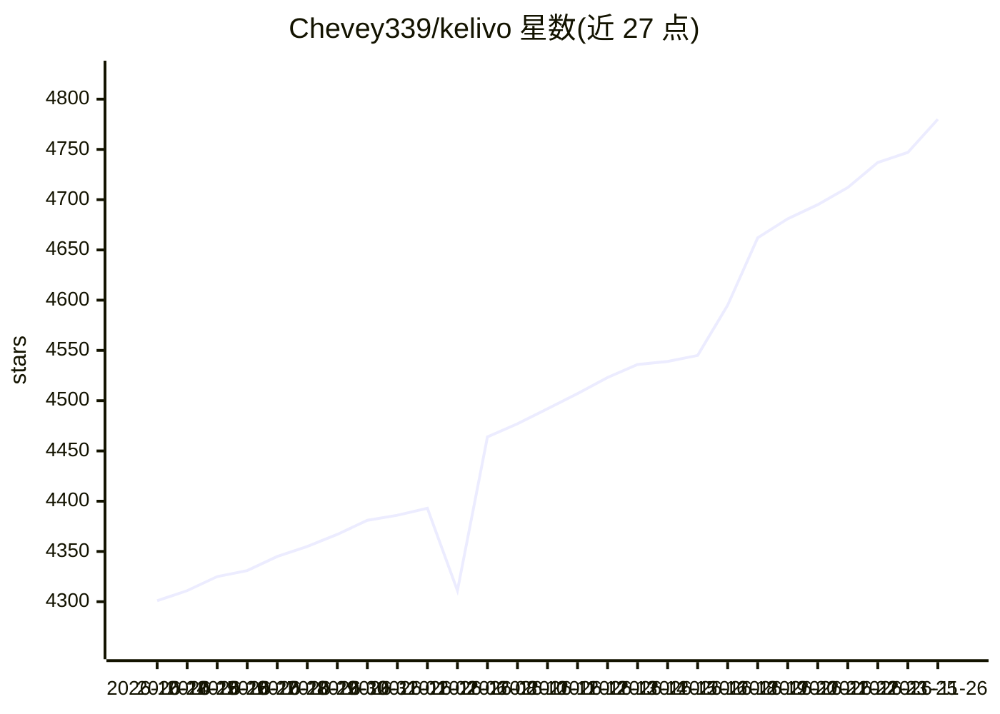

# Chevey339/kelivo

⭐ 4,780 · Dart · AGPL-3.0 · 推送 2026-11-25 · [GitHub](https://github.com/Chevey339/kelivo) · [官网](https://kelivo.psycheas.top) · 个人维护 · 中文 README

**跨平台移动与桌面 LLM 聊天客户端，多模型接入**

Kelivo 是用 Flutter 构建的开源 LLM 客户端，覆盖 Android、iOS、macOS、Windows、Linux 与 HarmonyOS。用户接入自己的 API key 或订阅账号，可在 OpenAI、Gemini、Claude、DeepSeek、OpenRouter 等 OpenAI 兼容服务间切换。除聊天外，模型可调用 MCP 服务器、技能、网络搜索，并可绑定工作区读取/编辑文件与运行命令（手机端经 Linux 沙箱，桌面端经系统 shell）。数据本地存储，无自有账号系统，支持 WebDAV/S3 备份与从 Cherry Studio、Chatbox 导入。

## 筛选速览

| 维度 | 判定 | 备注 |
|---|---|---|
| AI 角色 | `ai-native` | 本体是模型或模型工具 |
| 许可风险 | `viral` | AGPL-3.0 |
| 部署形态 | `desktop` | 安装包/桌面程序 |
| 模型依赖 | — | README 未给出锁定关系 |
| 硬件要求 | — | 无带数字的原话,不猜 |
| 安装摩擦 | `high` | 编译与系统依赖俱全 |
| 成熟度 | — | 结构信号不足 |

## 能力要点

- 一套应用接入 OpenAI、Gemini、Claude、DeepSeek、OpenRouter 等及任意 OpenAI 兼容端点
- 工作区为模型提供 8 种文件/终端工具，移动端经 PRoot/iSH 运行 Linux 沙箱
- MCP 服务器连接（Streamable HTTP/SSE/STDIO），支持 OAuth 与按工具审批
- 长期记忆管线、世界书、技能导入与定时任务

## 适用场景

- 在手机和电脑上用一个应用切换多家模型服务
- 让模型在本地工作区里读写文件、执行命令完成任务
- 数据留在本机的私密聊天与 WebDAV/S3 备份
- 为不同助手配置模型、提示词、工具与记忆

## 场景标签

`聊天机器人` `AI 助手` · 领域:对话与助手

## 证据(README 行号)

> L5: **An open-source LLM client for mobile and desktop.**
> L26: Kelivo is a cross-platform LLM client built with Flutter for Android, iOS, macOS, Windows and Linux. Connect your o
> L28: Kelivo goes beyond chat. Models can search the web, call MCP servers, follow skills and remember what matters to yo

## 星数曲线

2026-10-24 4,301 → 2026-11-26 4,780（+479）

---
*卡片 v1 · prompt 1.4 · 生成 2026-11-26 · 置信度 high · 依据 README sha `076e5b2ccfcc` · [字段定义](../../DATASET.md)*
