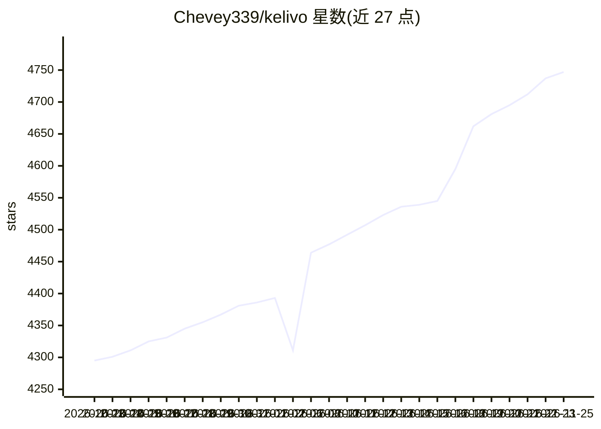

# Chevey339/kelivo

⭐ 4,747 · Dart · AGPL-3.0 · 推送 2026-11-23 · [GitHub](https://github.com/Chevey339/kelivo) · [官网](https://kelivo.psycheas.top) · 个人维护 · 中文 README

**移动与桌面通用的开源 LLM 聊天客户端**

基于 Flutter 的跨平台 LLM 客户端，覆盖 Android、iOS、macOS、Windows 与 Linux，另有 HarmonyOS 版本。用户填入自有 API key 或登录订阅账号即可接入多家模型服务；数据与对话本地存储，支持 WebDAV/S3 备份。除聊天外提供工作区（shell 与文件读写八类工具）、手机端 Linux 沙箱（PRoot/iSH）、MCP 服务器接入、技能导入、长期记忆、网页搜索（24 个服务）、语音输入输出与图像生成等。通过 GitHub Releases 分发安装包，无内置账号体系。

## 筛选速览

| 维度 | 判定 | 备注 |
|---|---|---|
| AI 角色 | `ai-ecosystem` | LLM/agent 周边工具 |
| 许可风险 | `viral` | AGPL-3.0 |
| 部署形态 | `desktop` | 安装包/桌面程序 |
| 模型依赖 | — | README 未给出锁定关系 |
| 硬件要求 | — | 无带数字的原话,不猜 |
| 安装摩擦 | `medium` | 含编译或系统依赖之一 |
| 成熟度 | — | 结构信号不足 |

## 能力要点

- 接入自有 API key 或订阅账号，支持 OpenAI 兼容端点与自托管模型
- 工作区绑定会话，模型可执行 shell、读写文件等八类工具，桌面上走系统 shell
- 移动端通过 PRoot/iSH 运行 Linux 沙箱，可装 Python、Node.js 等工具
- MCP 服务器连接（HTTP/SSE/STDIO）与 SKILL.md 技能导入

## 适用场景

- 在手机和桌面用同一个应用切换多家模型服务
- 让模型在工作区里读写文件并执行命令完成实际任务
- 对话数据本地保存并用 WebDAV 或 S3 定期备份
- 从 Cherry Studio 或 Chatbox 迁移已有配置

## 场景标签

`聊天机器人` `图像生成` · 领域:对话与助手

## 证据(README 行号)

> L5: **An open-source LLM client for mobile and desktop.**
> L26: Kelivo is a cross-platform LLM client built with Flutter for Android, iOS, macOS, Windows and Linux. Connect your o

## 星数曲线

2026-10-23 4,295 → 2026-11-25 4,747（+452）

---
*卡片 v1 · prompt 1.4 · 生成 2026-11-22 · 置信度 high · 依据 README sha `f723645676b9` · [字段定义](../../DATASET.md)*
