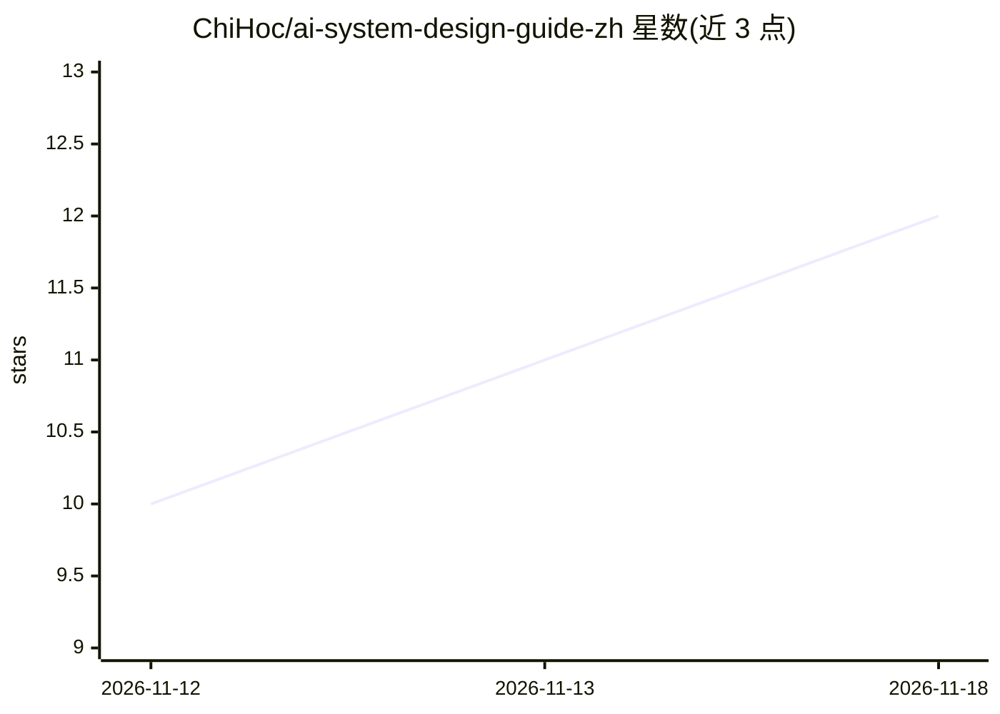

# ChiHoc/ai-system-design-guide-zh

⭐ 12 · JavaScript · MIT · 推送 2026-11-12 · [GitHub](https://github.com/ChiHoc/ai-system-design-guide-zh) · [官网](https://chihoc.github.io/ai-system-design-guide-zh/) · 个人维护 · 中文 README

**AI 系统设计指南的简体中文镜像阅读站，面向面试与生产参考**

由 ChiHoc 维护的非官方简体中文镜像仓库，上游为 ombharatiya 的英文 AI 系统设计指南（MIT 许可）。内容覆盖 AI 系统设计、RAG 架构、LLM 工程、智能体、MCP/A2A 协议与 AI 工程面试准备，含 193 道面试题库、案例研究、配套评估深度指南与词汇表，以活文档形式持续更新。本仓库提供中文阅读站（VitePress 构建），英文上游是内容事实与版权的唯一来源。

## 筛选速览

| 维度 | 判定 | 备注 |
|---|---|---|
| AI 角色 | `ai-knowledge` | 知识聚合/清单类 |
| 许可风险 | `permissive` | MIT |
| 部署形态 | `None` |  |
| 模型依赖 | — | README 未给出锁定关系 |
| 硬件要求 | — | 无带数字的原话,不猜 |
| 安装摩擦 | `low` | 无编译、无系统依赖或容器化 |
| 成熟度 | — | 结构信号不足 |

## 能力要点

- 193 道 AI 工程面试题库与答题框架、白板练习
- 覆盖 RAG、智能体、MCP/A2A、评估、多租户等章节结构
- 15 个真实面试场景案例研究（含完整解法与图示）
- 非官方简体中文镜像，使用 VitePress 构建

## 适用场景

- 准备 AI 工程与系统设计面试时查阅题库与答题框架
- 学习生产级 RAG 与智能体系统的设计模式
- 查阅模型选型、定价与评估方法的中文参考资料

## 场景标签

`教程课程` · 领域:学习与行业

## 证据(README 行号)

> L2: > 本仓库是由 ChiHoc 维护的非官方简体中文镜像；英文上游是正文事实与版权归属的唯一来源。下方保留的作者、社交账号与原阅读站信息均属于英文上游项目。
> L28: 这是一份实用且持续更新的指南，覆盖 AI system design（AI 系统设计）、RAG architectures（RAG 检索增强生成架构）、LLM engineering（LLM 工程）、agentic AI（智能体化
> L116: ├── 00-interview-prep/           # Questions (193), frameworks, exercises, job-market trends (November 2026)

## 星数曲线

2026-11-12 10 → 2026-11-18 12（+2）

---
*卡片 v1 · prompt 1.4 · 生成 2026-11-18 · 置信度 high · 依据 README sha `48fab484d044` · [字段定义](../../DATASET.md)*
