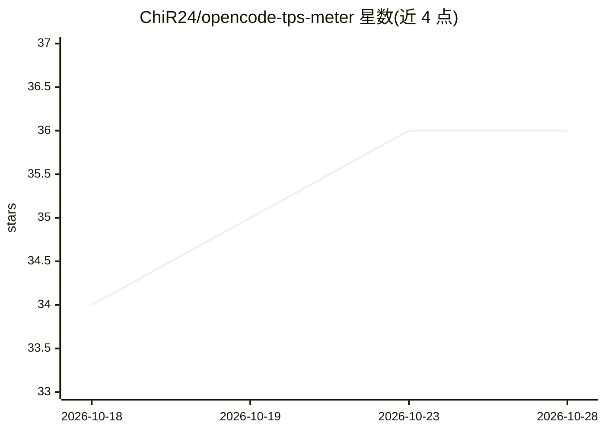

# ChiR24/opencode-tps-meter

⭐ 36 · TypeScript · 推送 2026-10-24 · [GitHub](https://github.com/ChiR24/opencode-tps-meter) · 个人维护

**OpenCode 插件：实时显示 AI token 吞吐率（TPS）仪表**

面向 OpenCode 终端 AI 编码工具的 TypeScript 插件，在 TUI 中实时显示 tokens-per-second 滚动窗口速率、token 总数与 prompt 缓存命中率。仅统计 assistant 角色输出，排除用户/系统消息、工具结果与文件内容。单包同时支持 OpenCode v1 与 v2（以独立二进制并存），v2 上提供基于 provider 上报 token 数的校准估算、TTFT、子 agent 分速率、持久化吞吐台账与 /tps 仪表盘。通过 opencode plug 或 npm 安装，配置可由项目/全局 JSON、环境变量与内联选项分层合并。

## 筛选速览

| 维度 | 判定 | 备注 |
|---|---|---|
| AI 角色 | `ai-ecosystem` | LLM/agent 周边工具 |
| 许可风险 | `none` | — |
| 部署形态 | `library` | 以包/库形式分发 |
| 模型依赖 | — | README 未给出锁定关系 |
| 硬件要求 | — | 无带数字的原话,不猜 |
| 安装摩擦 | `low` | 无编译、无系统依赖或容器化 |
| 成熟度 | — | 结构信号不足 |

## 能力要点

- 仅统计 assistant 输出的实时 TPS 与缓存命中率显示
- 单包兼容 OpenCode v1 与 v2 两代插件 API
- v2 支持 provider token 数校准、TTFT、子 agent 分速率与持久化台账
- 增量式 token 计数，长响应处理为线性复杂度

## 适用场景

- 在 OpenCode 编码会话中实时查看模型吐字速度
- 比较不同模型/时段的吞吐率与 TTFT（持久化台账）
- 通过缓存命中率观察 prompt cache 生效情况

## 场景标签

`LLM 可观测性` · 领域:评测与运维

## 证据(README 行号)

> L3: **Real-time AI token throughput visualization for OpenCode**
> L17: A live tokens-per-second meter plugin for OpenCode. Track AI token throughput in real-time with a configurable roll

## 星数曲线

2026-10-18 34 → 2026-10-28 36（+2）

---
*卡片 v1 · prompt 1.4 · 生成 2026-10-25 · 置信度 high · 依据 README sha `53c2ed0f1fb6` · [字段定义](../../DATASET.md)*
