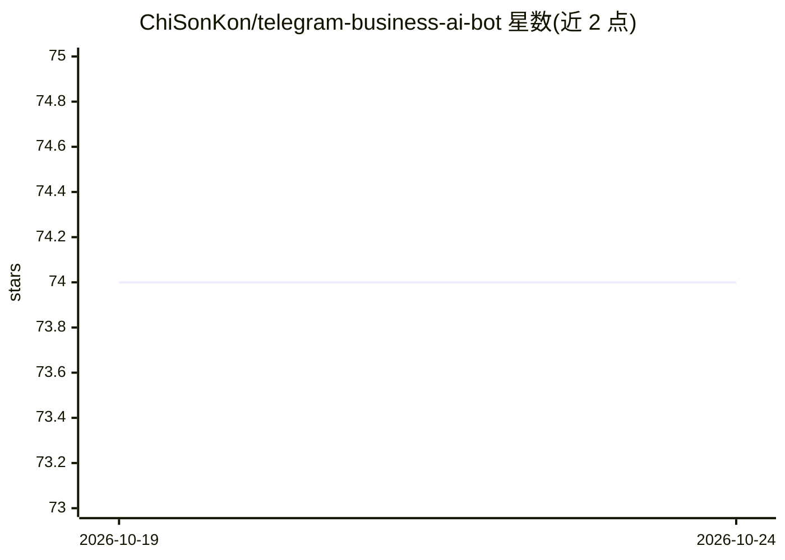

# ChiSonKon/telegram-business-ai-bot

⭐ 74 · Python · Apache-2.0 · 推送 2026-10-19 · [GitHub](https://github.com/ChiSonKon/telegram-business-ai-bot) · 组织维护 · 中文 README

**面向业务账号的 Telegram 双向智能客服机器人**

同时服务 Telegram Bot 私聊与 Business「秘书机器人」会话的双向客服系统：规则驱动的前台先分流并用 2–5 个问题预检需求（预检阶段不耗 token），再交给 AI 问答；基于 knowledge_base.json 按业务线做 RAG 检索，并设守卫拦截未授权的金额、链接与收款地址。支持人工一键接管（话题式管理群）、/admin 与 /cfg 的 Telegram 内控制台、GMPay(EPUSDT) USDT 收款，中英双语。多模型容灾，兼容 DeepSeek / OpenAI 兼容 API / Ollama。源码部署，需自备 Bot Token 与 LLM API Key，上线前需替换默认业务知识与话术。

## 筛选速览

| 维度 | 判定 | 备注 |
|---|---|---|
| AI 角色 | `ai-native` | 本体是模型或模型工具 |
| 许可风险 | `permissive` | Apache-2.0 |
| 部署形态 | `library` | 以包/库形式分发 |
| 模型依赖 | local-ok | 支持本地模型 |
| 硬件要求 | — | 无带数字的原话,不猜 |
| 安装摩擦 | `low` | 无编译、无系统依赖或容器化 |
| 成熟度 | — | 结构信号不足 |

## 能力要点

- Bot 私聊与 Business 秘书模式双通道，按通道能力自动降级
- RAG 知识库检索 + 守卫拦截未授权金额/链接/收款地址
- 多模型容灾（DeepSeek / OpenAI 兼容 / Ollama），主模型失败自动切备用
- 话题式人工接管与 Telegram 内控制台 /admin、/cfg

## 适用场景

- 在 Telegram 上为业务账号提供 24 小时双语智能客服
- 客户咨询自动分流预检后转 AI 或人工同事接手
- 通过 GMPay 网关自动收取 USDT 款项并自动交付

## 场景标签

`聊天机器人` `RAG` · 领域:对话与助手

## 证据(README 行号)

> L14:  面向业务账号的 Telegram 双向智能客服:同时服务 Bot 私聊与 Business 会话。规则驱动的前台接待 + AI 问答 + 人工一键接管 + USDT 收款 + Telegram 内可视化后台。
> L21: - **AI 问答 + 知识库**:`knowledge_base.json` 按业务线检索注入,防价格/链接/地址幻觉(守卫会拦截未授权的金额、链接与收款地址);多模型容灾(DeepSeek / OpenAI 兼容 / Olla

## 星数曲线

2026-10-19 74 → 2026-10-24 74（+0）

---
*卡片 v1 · prompt 1.4 · 生成 2026-10-24 · 置信度 mid · 依据 README sha `158f1c244aa0` · [字段定义](../../DATASET.md)*
