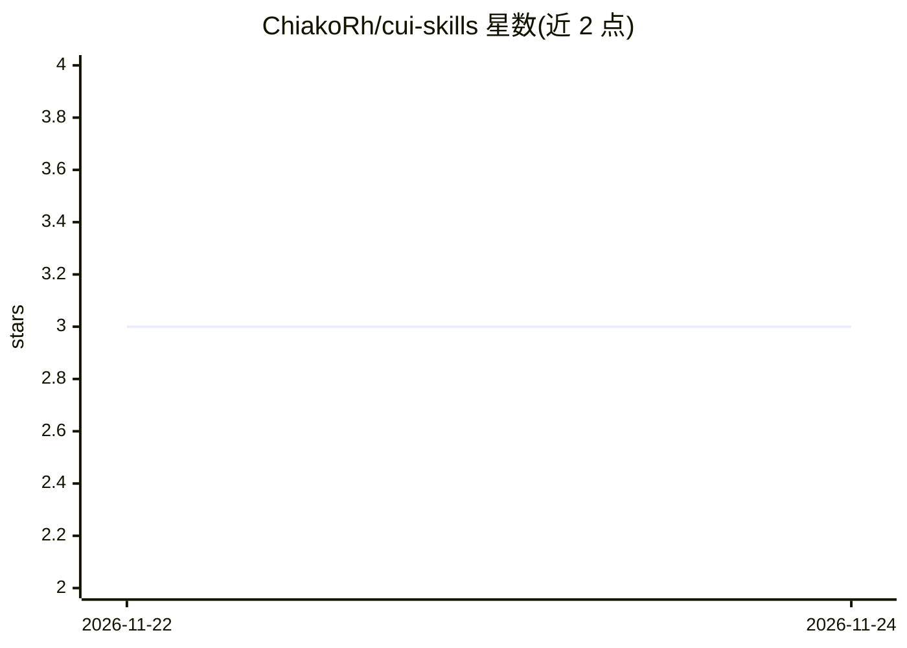

# ChiakoRh/cui-skills

⭐ 3 · HTML · MIT · 推送 2026-11-21 · [GitHub](https://github.com/ChiakoRh/cui-skills) · 个人维护

**面向 AI agent 的 CUI 界面开发技能集（4 个）**

四个 agent 技能（cui-app/cui-web/cui-py/cui-style），供 AI agent 遵循以构建基于 CUI 与 nexa UI 的界面，覆盖 C99 原生桌面、WebAssembly、Python 桌面与纯 CSS 四个层次。内容来自实际构建与测试记录：组件清单、可复制模式、CMake 模板、浏览器约束、RTL/波斯语支持。提供 slash 命令或对话式安装流程，将技能复制进 OpenCode/Claude Code 等 agent 的技能目录。

## 筛选速览

| 维度 | 判定 | 备注 |
|---|---|---|
| AI 角色 | `ai-knowledge` | 知识聚合/清单类 |
| 许可风险 | `permissive` | MIT |
| 部署形态 | `library` | 以包/库形式分发 |
| 模型依赖 | — | README 未给出锁定关系 |
| 硬件要求 | — | 无带数字的原话,不猜 |
| 安装摩擦 | `medium` | 含编译或系统依赖之一 |
| 成熟度 | — | 结构信号不足 |

## 能力要点

- 四个技能对应四个层：C99 原生、WASM、Python、纯 CSS，共享同一 token 系统
- 约 210 个原生组件的完整分类清单与可复制 UI 模式
- 内建 RTL/波斯语文本整形支持，覆盖各层
- 提供面向 agent 的自动安装流程（slash 命令或对话）与 paths.json 路径记录

## 适用场景

- 让 agent 用 C 构建桌面工具/应用
- 把同一 C 代码库编译为浏览器 WASM 应用
- 让 agent 用 Python 做 GUI 或给网站套用 CUI 风格

## 场景标签

`提示工程` · 领域:Agent 开发

## 证据(README 行号)

> L5: Four agent skills for building UIs with CUI — one visual language across **C**, **WebAssembly**, **Python** and **pl
> L99: 1. **Slash command** — copy `commands/cui-setup.md` into your agent's command directory (OpenCode: `~/.config/openc
> L140: |Agent|Destination|
> L142: |OpenCode|`~/.config/opencode/skills/`|

## 星数曲线

2026-11-22 3 → 2026-11-24 3（+0）

---
*卡片 v1 · prompt 1.4 · 生成 2026-11-22 · 置信度 mid · 依据 README sha `cd8e2967c71e` · [字段定义](../../DATASET.md)*
