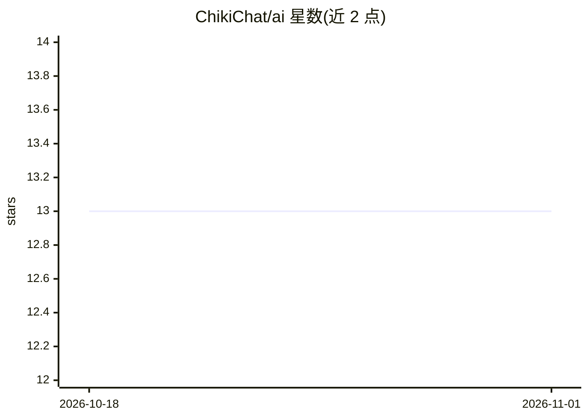

# ChikiChat/ai

⭐ 13 · TypeScript · Apache-2.0 · 推送 2025-11-24 · [GitHub](https://github.com/ChikiChat/ai) · [官网](https://models.chiki.chat) · 组织维护

**帮助开发者用统一接口构建多供应商 AI 应用的 TypeScript 工具包**

基于 AI SDK 的 TypeScript 工具包，面向在 Next.js、React、Svelte、Vue 及 Bun、Node.js 等运行时上构建 AI 应用的开发者。核心机制：为多家 AI 供应商（AI21 Labs、Anthropic、Cohere、Google Generative AI 等）提供统一接口，消除分别管理多个 API 与凭证的需要；支持跨供应商切换以比较服务与测试模型；提供跨供应商的用量与成本跟踪功能。README 未展示安装命令与代码示例，采用 Apache 2.0 许可证。

## 筛选速览

| 维度 | 判定 | 备注 |
|---|---|---|
| AI 角色 | `ai-ecosystem` | LLM/agent 周边工具 |
| 许可风险 | `permissive` | Apache-2.0 |
| 部署形态 | `None` |  |
| 模型依赖 | — | README 未给出锁定关系 |
| 硬件要求 | — | 无带数字的原话,不猜 |
| 安装摩擦 | `low` | 无编译、无系统依赖或容器化 |
| 成熟度 | — | 结构信号不足 |

## 能力要点

- 多家 AI 供应商的统一接口
- 跨供应商的用量与成本跟踪
- 支持在供应商间切换以比较服务与测试模型
- 适配 Next.js/React/Svelte/Vue 与 Bun/Node.js

## 适用场景

- 在 Web 应用中接入多家 AI 供应商而无需分别管理 API
- 跟踪和优化多供应商 AI 服务成本
- 在不同供应商模型间切换做对比测试

## 场景标签

`模型网关` `LLM 可观测性` · 领域:Agent 开发

## 证据(README 行号)

> L3: The AI SDK is a TypeScript toolkit designed to help you build AI-powered applications
> L14:  interface for interacting with multiple AI providers.

## 星数曲线

2026-10-18 13 → 2026-11-01 13（+0）

---
*卡片 v1 · prompt 1.4 · 生成 2026-10-31 · 置信度 high · 依据 README sha `9410a2c1c4fb` · [字段定义](../../DATASET.md)*
