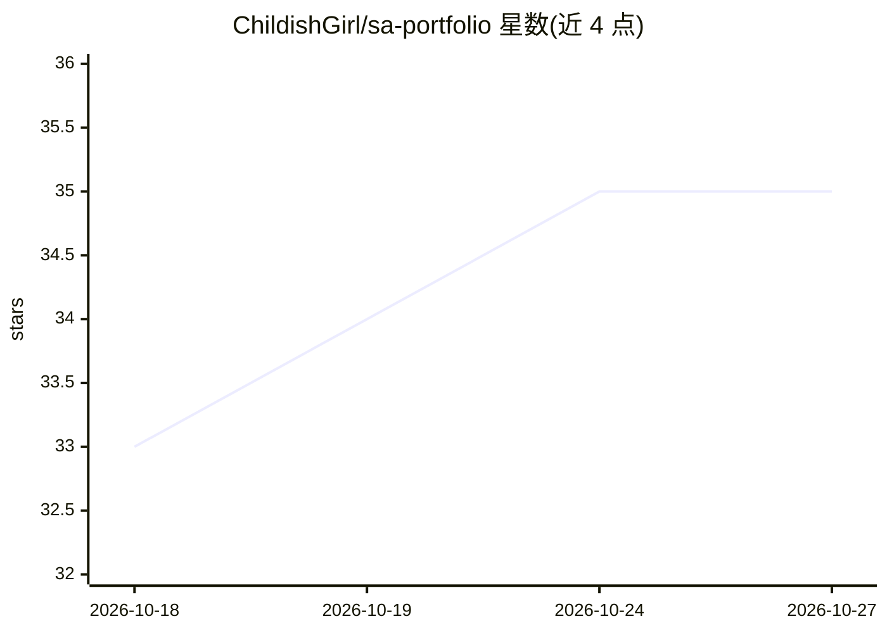

# ChildishGirl/sa-portfolio

⭐ 35 · HTML · 推送 2026-05-23 · [GitHub](https://github.com/ChildishGirl/sa-portfolio) · [官网](https://childishgirl-portfolio.vercel.app) · 个人维护

**AWS 解决方案架构师作品集：含多个数据/AI 真实案例研究**

个人（Anna Pastushko）AWS 解决方案架构师的作品集 README，收录保险、零售、医疗、农业四个行业的匿名化客户案例，覆盖混合 RAG 知识检索、RAG 聊天机器人、HIPAA 合规数据湖与 MLOps、IoT 事件驱动流水线。每个案例包含问题、方案架构、职责与技术栈，README 明示可作为架构师与工程师的模板复用。仓库为文档型内容，不含可运行软件。

## 筛选速览

| 维度 | 判定 | 备注 |
|---|---|---|
| AI 角色 | `ai-knowledge` | 知识聚合/清单类 |
| 许可风险 | `none` | — |
| 部署形态 | `None` |  |
| 模型依赖 | — | README 未给出锁定关系 |
| 硬件要求 | — | 无带数字的原话,不猜 |
| 安装摩擦 | `low` | 无编译、无系统依赖或容器化 |
| 成熟度 | — | 结构信号不足 |

## 能力要点

- 4 个行业案例：保险/零售/医疗/农业
- 案例含架构决策（如 OpenSearch vs Bedrock Knowledge Bases）与技术栈清单
- README 明示可作为架构师/工程师作品集模板

## 适用场景

- 搭建自己的解决方案架构师作品集
- 参考 AWS 数据与 AI/ML 架构的案例写法
- 了解 RAG、MLOps、数据湖在真实项目中的架构决策

## 场景标签

 · 领域:云计算/解决方案架构（文档）

## 证据(README 行号)

> L1: # Anna Pastushko
> L34: ## 🏛 Insurance knowledge retrieval solution
> L57: **Technology stack:** Amazon OpenSearch, Amazon Bedrock, ECS, DynamoDB, Langfuse, GitHub.

## 星数曲线

2026-10-18 33 → 2026-10-27 35（+2）

---
*卡片 v1 · prompt 1.4 · 生成 2026-10-25 · 置信度 mid · 依据 README sha `e1461fb7e120` · [字段定义](../../DATASET.md)*
