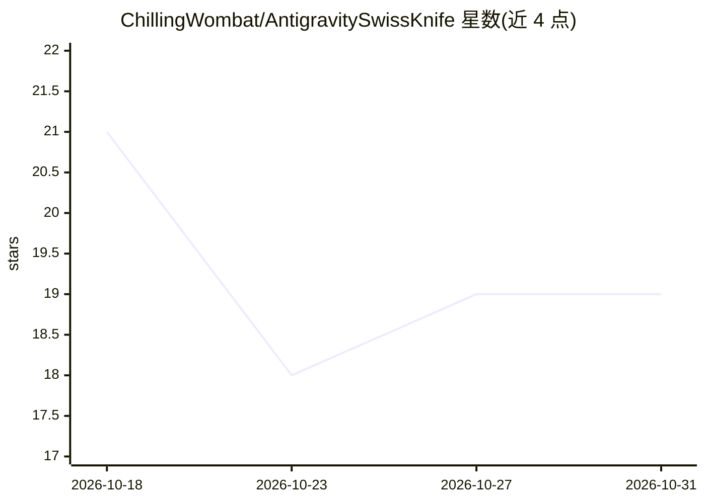

# ChillingWombat/AntigravitySwissKnife

⭐ 19 · Go · MIT · 推送 2026-10-30 · [GitHub](https://github.com/ChillingWombat/AntigravitySwissKnife) · 个人维护

**Google Antigravity 的跨平台桌面伴生工具与后台守护进程**

面向 Google Antigravity 2.0 IDE（含 CLI 与 VS Code 扩展）用户的 Electron+Go 桌面伴生应用与后台守护进程：提供账号切换（OS 钥匙串+硬件指纹虚拟化）、BYOK 自定义模型路由（Anthropic/OpenAI/Google AI Studio/DeepSeek/GCP Vertex AI/本地 Ollama）、反向代理远程控制（Cloudflare/Tailscale 等四种隧道）、OAuth 2.0/2.1 MCP 授权服务器、Token 用量实时监控、预览浏览器/文件管理器/GitHub 工作区等内置工具。采用零代理架构，凭据本地 AES-256-GCM 加密存储。提供 Linux/Windows/macOS 安装包与源码构建方式。

## 筛选速览

| 维度 | 判定 | 备注 |
|---|---|---|
| AI 角色 | `ai-ecosystem` | LLM/agent 周边工具 |
| 许可风险 | `permissive` | MIT |
| 部署形态 | `desktop` | 安装包/桌面程序 |
| 模型依赖 | local-ok | 支持本地模型 |
| 硬件要求 | — | 无带数字的原话,不猜 |
| 安装摩擦 | `low` | 无编译、无系统依赖或容器化 |
| 成熟度 | `idea` | |

## 能力要点

- 多账号切换，凭据存于 OS 钥匙串并虚拟化硬件指纹
- BYOK 模型路由：Anthropic/OpenAI/DeepSeek/GCP Vertex AI/本地 Ollama
- 4 种远程隧道模式与内置 OAuth 2.0/2.1 MCP 授权服务器（PKCE）
- Token 实时遥测：上下文追踪、tokens/s 速率与美元计价

## 适用场景

- 在多 Google 账号间安全切换 Antigravity 会话
- Gemini 配额不足时用 BYOK 或本地 Ollama 模型承接溢出任务
- 通过隧道远程访问 Antigravity Web App 并监控 Token 花费

## 场景标签

`模型网关` `LLM 可观测性` · 领域:Agent 开发

## 证据(README 行号)

> L5:  Cross-platform desktop companion and background daemon for Google Antigravity.
> L17: Antigravity Swiss Knife is a cross-platform desktop companion and background daemon for Antigravity 2.0, CLI and VS
> L35: - **Zero-Proxy Model Routing**: Bring-Your-Own-Key integration for Anthropic, OpenAI, Google AI Studio, DeepSeek, G

## 星数曲线

2026-10-18 21 → 2026-10-31 19（-2）

---
*卡片 v1 · prompt 1.4 · 生成 2026-10-29 · 置信度 high · 依据 README sha `5e262f940f3c` · [字段定义](../../DATASET.md)*
