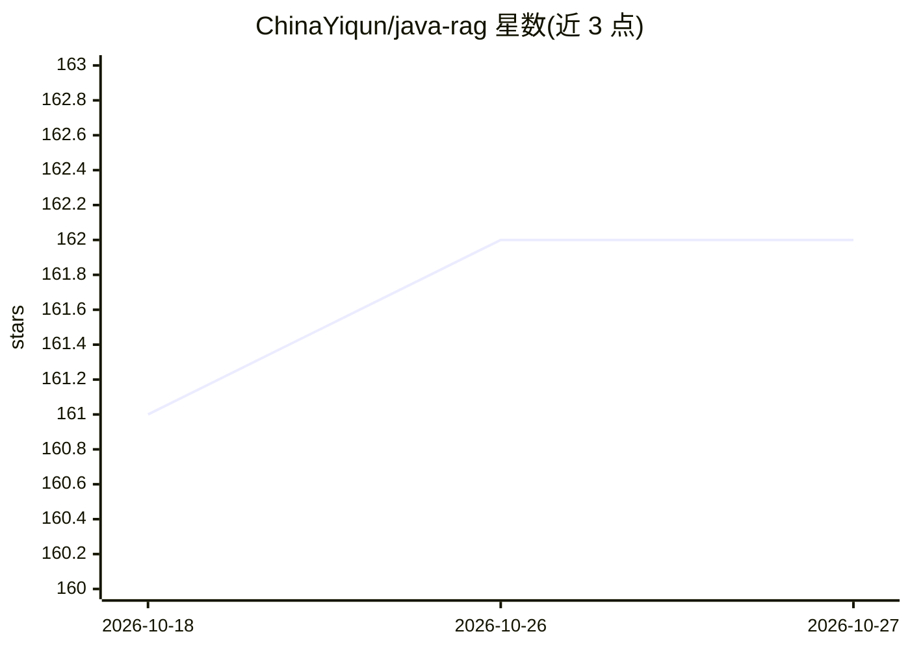

# ChinaYiqun/java-rag

⭐ 162 · Java · Apache-2.0 · 推送 2026-07-29 · [GitHub](https://github.com/ChinaYiqun/java-rag) · 个人维护 · 中文 README

**纯 Java 实现的 RAG 工具包与可视化 Playground**

面向 Java 开发者的无框架 RAG 工具包：实现解析、分块、嵌入、检索、Top-K 上下文构造与带出处的回答生成完整流程，兼容 Java 8，不依赖 Spring Boot 等强制框架。附带 React 三面板可视化 Playground（Docker Compose 一键启动），默认本地抽取式演示无需 API key，可选 Ollama 配置接入本地语言模型，并支持 OpenAI 兼容接口自定义 provider。内置多种解析器、分块策略与 Elasticsearch/Redis/MySQL/MinIO 集成组件；AdvancedRAG/ModularRAG 处于实验状态，持久化索引与评测为规划项。

## 筛选速览

| 维度 | 判定 | 备注 |
|---|---|---|
| AI 角色 | `ai-ecosystem` | LLM/agent 周边工具 |
| 许可风险 | `permissive` | Apache-2.0 |
| 部署形态 | `self-host` | docker 或自建部署 |
| 模型依赖 | local-ok | 支持本地模型 |
| 硬件要求 | — | 无带数字的原话,不猜 |
| 安装摩擦 | `low` | 无编译、无系统依赖或容器化 |
| 成熟度 | `idea` | |

## 能力要点

- 完整 RAG 数据流的纯 Java 8+ 实现，无强制应用框架
- React 三面板可视化 Playground，展示回答引用的 Chunk 与 Top-K 原文
- 默认模式完全本地运行，无需 API key 或模型下载，可选 Ollama 本地 LLM 配置
- 内置 PDF/Word/PPT/Excel/Markdown/HTML 解析与多种分块、检索、重排组件

## 适用场景

- 学习 RAG 内部机制并观察检索证据
- 在既有 Java 系统中嵌入框架无关的 RAG 组件
- 替换自定义 splitter、embedding 与 OpenAI 兼容 chat provider 做实验

## 场景标签

`RAG` · 领域:知识与检索

## 证据(README 行号)

> L17: Java-RAG is a pure-Java implementation of the complete RAG data flow:
> L23: It is designed for developers who want to **learn RAG internals**, **embed RAG into an existing Java system**, or *
> L68: - **Provider-neutral interfaces** — inject your own splitter, embedding service and OpenAI-compatible chat provider

## 星数曲线

2026-10-18 161 → 2026-10-27 162（+1）

---
*卡片 v1 · prompt 1.4 · 生成 2026-10-22 · 置信度 mid · 依据 README sha `8913e6baddae` · [字段定义](../../DATASET.md)*
